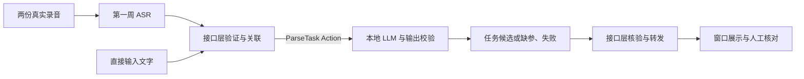

# 第二周共同任务：部署 LLM，打通任务理解与展示

第一周 AI 岗位已安排 ASR，第二周复用这部分成果，主线推进到 **LLM 本地部署、结构化任务理解和接口联调**。先读[知识导航](../../知识点/README.md)，再读个人任务。第一周原始任务书保留，当前周以本页约定为准。

## 一、本周交付目标



先打通文字入口，再接回语音入口。候选只用于展示和人工核对，本周不下发机器人动作。

| 岗位 | 第二周新增工作 | 任务书 |
|---|---|---|
| AI 端侧 | Ollama 与本地模型部署；提示词、JSON 校验、ParseTask Action 服务 | [LLM 部署与使用](AI端侧工程师.md) |
| 接口调用 | 文字/ASR 双入口；异步 Action 客户端、关联校验、去重、超时取消、结构化转发 | [语义接口与异常处理](接口调用工程师.md) |
| 可视化与监控 | 显示识别文字、解析进度、任务字段、缺参追问和失败；按编号保存与选择 | [任务理解监控窗口](机器人可视化与监控工程师.md) |

参考项目已核对版本 `b878b98` 有文件收发、ASR 和公共类型；`ai_edge` 与可视化主体仍待开发。下面的 `parse_task_node`、`semantic_bridge`、`monitor_ui` 是本周要新增的入口，不能当作已有功能。当前仓库较完整的实现用于截取学习和复用，不代表参考项目已通过本周验收。

## 二、先统一接口与数据

### 输入、输出与负责方

| 端点 | 类型 | 负责方与用途 |
|---|---|---|
| `/interaction/user_text` | `robot_interfaces/msg/UserText` | 接口岗位接收直接文字；界面或 CLI 发布 |
| `/interaction/asr_text` | `robot_interfaces/msg/RecognizedText` | 沿用第一周转发，接口岗位筛选有效识别文字 |
| `/ai/parse_task` | `robot_interfaces/action/ParseTask` | AI 岗位新增服务；接口岗位作为客户端 |
| `/ai/request_status` | `robot_interfaces/msg/RequestStatus` | AI 岗位报告 Goal 拒绝原因；接口岗位关联并转交 |
| `/interaction/parse_status` | `robot_interfaces/msg/AudioProcessingState` | 接口岗位把 Action 反馈映射为窗口阶段 |
| `/interaction/parse_result` | `robot_interfaces/msg/TaskParseReport` | 接口岗位核验完整结果后发布一次 |
| `/interaction/request_status` | `robot_interfaces/msg/RequestStatus` | 接口岗位报告输入受理、拒绝与编号冲突 |
| `/interaction/asr_status` | `robot_interfaces/msg/AudioProcessingState` | 第一周状态转发继续保留 |

继续使用现有 `robot_interfaces`，不新造同义消息。两个阶段的 `AudioProcessingState` 要保留 `source_node`、`boot_id`、`event_seq`，解析阶段的 `operation` 为 `/ai/parse_task`。Goal 被拒绝不会有自定义 Result，AI 通过受理回执提供原因；接口不能永远等待。Action 的 QUEUED 映射 WAITING_PARSE，INFERENCING/VALIDATING 映射 PARSING；最终映射 READY、NEED_CLARIFICATION、FAILED 或 CANCELED，不用自造枚举值。

### 编号与入口校验

- 直接文字：发布者生成新 `request_id`，填写 `session_id`、`input_context_id`；`input_id` 使用 `text:<request_id>`。接口层保留这四个字段。
- 语音：只接受 `success=true`、`status=SUCCESS` 且 `text.strip()` 非空的结果；沿用 `request_id/session_id/input_context_id`，Goal 的 `input_id` 使用 `audio:<segment_id>`。不修改原识别文字。
- 本周文字入口限制 1～4096 字，四个身份字段不得为空；空白、缺编号或状态矛盾的输入以 `INVALID_REQUEST` 拒绝，正常的 ASR 无语音/失败不调用 LLM。
- 同一进程保存最近至少 100 个已见请求：同编号、同来源与同内容不再次调用；同编号但内容/来源不同以 `REQUEST_ID_CONFLICT` 拒绝，只发拒绝回执，不覆盖原请求结果。测试范围是缓存保留期内，不声称跨重启持久化去重。
- 接口桥和 AI 服务均先采用单任务在途模式。第二个不同请求在忙碌时明确拒绝，接口层用 `PIPELINE_BUSY`，AI 服务端用 `LLM_BUSY`；本周不强求排队调度。

### 候选与结果规则

模型输出使用项目 `TaskCandidate` 对应字段：`task_type`、五个 ID 字段、`return_required`、`steps`。本周主做 NAVIGATE、TRANSPORT，未使用字段为空字符串，`steps=[]`；未知任务用 UNKNOWN。JSON 中任务类型使用名称，转换 ROS 时使用现有枚举。

| 业务结果 | Action 终态 | `outcome` / `success` | 关键字段 |
|---|---|---|---|
| 候选完整且白名单合法 | SUCCEEDED | READY / true | `error_code`、缺参和追问为空 |
| 缺少必填参数 | SUCCEEDED | NEED_CLARIFICATION / false | `MISSING_FIELDS`、实际缺失字段、追问；保留已知候选 |
| 不支持的指令 | ABORTED | UNSUPPORTED / false | `UNSUPPORTED_TASK`，不携带可执行候选 |
| 模型、输出或校验错误 | ABORTED | FAILED / false | 明确错误码与说明 |
| 已接受的取消请求 | CANCELED | CANCELED / false | `CANCELED`，迟到结果丢弃 |

白名单是本轮 Goal 的实际配置，不是提示词中的示例。当前测试使用工位 `station_a、station_b、station_c`，物料 `box_1、box_2`；部署时可换配置。模型不得编造缺失物料或地点，非法 JSON、未知 ID、互斥字段冲突不能成为 READY。提示词与 Schema 只辅助模型生成，程序仍须独立校验。

接口层除了检查四个身份字段，还要检查 Action 终态、`outcome/success/error_code` 的一致性以及 READY 候选的类型、必填字段与白名单。正常 Result 按字段复制到 `TaskParseReport`；本地拒绝、断连或超时也需生成对应失败说明，不伪装成模型成功结果。

## 三、开发与联调顺序

### 先部署并验证 LLM

AI 同学按[个人任务](AI端侧工程师.md)准备 Ollama，沿用当前完整项目默认模型 `qwen3.5:2b`。记录真实版本、模型标签、运行设备与耗时。机器资源不够时可协商更小模型，但需更新配置并复跑同一测试集。

### 再实现纯文字链路

AI 同学先交付可复现的 Python HTTP 调用和输出校验，再提供 `/ai/parse_task`。接口同学先用替身验证调用状态机，然后对接真实 Action；可视化同学接结构化结果。纯文字能绕过 ASR，便于区分“识别错字”和“LLM 理解错误”。

本周新增代码完成后，再执行目标构建：

```bash
source /opt/ros/humble/setup.bash
cd ~/ros2-logistics-interaction/ai_interaction_ws
rosdep install --from-paths src --ignore-src -r -y
colcon build --symlink-install --packages-up-to ai_edge interaction_interface robot_visualization
source install/setup.bash
export ROS_DOMAIN_ID=173
```

每个 ROS 终端都加载同一环境和 `ROS_DOMAIN_ID`。以下是新增入口完成后的目标启动方式，不是当前参考项目开箱可用命令：

```bash
# AI 岗位新增；模型服务已经就绪后启动
ros2 run ai_edge parse_task_node --ros-args \
  -p model:=qwen3.5:2b -p ollama_url:=http://127.0.0.1:11434 \
  -p request_timeout:=60.0 -p num_ctx:=8192 -p num_predict:=1024

# 接口岗位新增；另一个终端启动
ros2 run interaction_interface semantic_bridge --ros-args \
  -p "allowed_station_ids:=[station_a, station_b, station_c]" \
  -p "allowed_object_ids:=[box_1, box_2]"

# 可视化岗位新增或在第一周入口上升级；另一个终端启动
ros2 run robot_visualization monitor_ui
```

参数统一：服务发现/Goal 应答等待 3 秒，AI HTTP 推理超时 60 秒，接口结果等待 70 秒；节点应允许配置，测试替身可使用更短时间。接口结果超时后发取消并丢弃迟到成功，不自动重发。取消不能强杀正在执行的 HTTP 请求，AI 端在底层调用结束前继续保持忙碌，避免越积越多。

也可先绕过接口桥，直接检查 AI Action 服务。下面是节点完成后的目标调用，`--feedback` 用来观察三个阶段：

```bash
ros2 action send_goal /ai/parse_task robot_interfaces/action/ParseTask \
  "{request_id: w2_action_01, session_id: w2, input_id: 'text:w2_action_01', input_context_id: w2_action, text: '导航到 station_b', allowed_station_ids: [station_a, station_b, station_c], allowed_object_ids: [box_1, box_2]}" --feedback
```

直接文字经过接口桥的测试：

```bash
ros2 topic pub --once /interaction/user_text robot_interfaces/msg/UserText \
  "{request_id: w2_text_01, session_id: w2, input_id: 'text:w2_text_01', input_context_id: w2_text, text: '把 box_1 从 station_a 送到 station_b'}"
```

接口桥必须已经订阅再发布；观察本次受理回执与解析结果，不能把 CLI 显示发布成功当成业务成功。重复使用同一编号是在测去重，新的业务测试应使用新编号。

### 最后接回第一周语音

ASR 与原转发只启动一套，沿用原有 `interaction.launch.py`、`audio_file_receiver`、`audio_file_sender`。准备两段包含不同任务的真实录音，依次发出；接收、ASR、LLM、接口桥和窗口不重启。

记录每段实际 ASR 文字与 LLM 候选。语音链路中缺参或失败要如实显示；如果 ASR 识别错误，再用相同实际文字从纯文字入口定位问题，不手改 ASR 输出冒充语音闭环成功。

## 四、共同验收

### 固定语义样例

T01～T08 使用真实模型，每例独立输入、`context=[]`、空的默认 `partial_candidate`；本周不要求多轮补参。测试脚本记录 HTTP 调用或模型调用证据，不能通过关键词分支绕过 LLM 来算模型通过。

| 用例 | 输入文本 | 应核对的结果 |
|---|---|---|
| T01 | 导航到 station_b | NAVIGATE，目标为 station_b |
| T02 | 把 box_1 从 station_a 送到 station_b | TRANSPORT，物料和起终点对应 |
| T03 | 把 box_2 从 station_b 送到 station_c，然后小车返回 station_a | TRANSPORT，返回要求与返回站保留 |
| T04 | 从 station_a 搬东西到 station_b | NEED_CLARIFICATION，仅缺 object_id，不能猜物料 |
| T05 | 把 box_1 运到 station_b | NEED_CLARIFICATION，缺 pickup_station_id |
| T06 | 帮我飞到天上 | UNSUPPORTED，不生成导航或搬运候选 |
| T07 | 导航到 station_z | UNKNOWN_STATION 等明确拒绝，不能改成已有工位 |
| T08 | 导航到 station_c | NAVIGATE，不沿用上一例的物料、起点或返回要求 |

每例至少保留一次真实运行记录，全部符合预期才通过该测试组；失败要记录实际输出与修正过程，再完整复跑，不能只留成功截图。另用注入式替身确定性测试非法 JSON、错误字段、忙碌、超时和迟到结果，替身结果单独标记。

| 编号 | 检查内容 | 完成要求与证据 |
|---|---|---|
| W2-01 | 第一周成果复用 | 至少一段真实录音经已有 ASR 得到真实文字，记录所用版本 |
| W2-02 | 本地 LLM 部署 | 模型已安装，本机 HTTP 请求实际返回；记录模型、版本、设备及耗时 |
| W2-03 | 模型结构化理解 | 真实模型完成 T01～T08，逐字段检查与留痕 |
| W2-04 | Action 服务 | Goal、阶段反馈、Result 和业务/Action 终态映射正确 |
| W2-05 | 双入口闭环 | 直接文字和两段真实录音均到达 LLM 与窗口，保留来源编号 |
| W2-06 | 关联与结果校验 | 四个身份字段核验；错编号、非法候选或矛盾终态被拒绝，无成功转发 |
| W2-07 | 去重与忙碌 | 重复输入只调用一次；冲突编号拒绝；忙碌时第二条明确拒绝、不隐式覆盖 |
| W2-08 | 模型不可用 | 错误模型标签或不可达测试地址得到明确错误；恢复配置后可处理下一条 |
| W2-09 | 超时与取消 | 慢响应替身下客户端超时发取消；服务端取消/超时终结；迟到结果不变成功 |
| W2-10 | 显示完整结果 | 显示文字、阶段、候选字段、追问与错误；切换历史不串用数据 |
| W2-11 | 连续运行 | 不重启完成两条不同任务和一次失败后的恢复，记录调用次数及结果 |
| W2-12 | 复现与退出 | 三岗位启动/配置/测试说明可复现，窗口与各自节点正常退出 |

共同填写[验收记录](验收记录模板.md)，标明“真实模型／替身”“通过／失败／未做”。本周不训练或微调模型，不做多轮记忆、复杂任务列表、跨机传输改造或机器人执行；这些是后续阶段，不替代本周 LLM 与接口交付。
