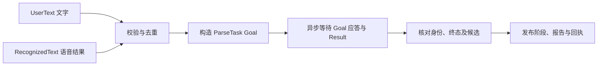
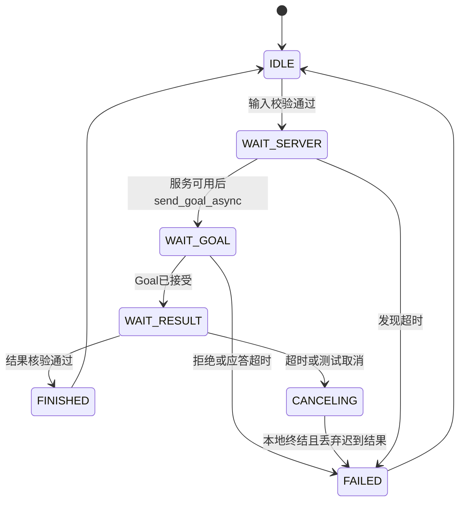

# 第二次任务：接口调用工程师

**本周目标：从原样转发升级为语义链路编排，连接 ASR、LLM Action 与窗口，保证请求可追踪、结果可信、失败可恢复。** 文件发送和 ASR 状态转发继续复用第一周成果，不以重复运行收发命令作为主要新增工作。

先读[接口知识清单](../../知识点/第二周/接口调用工程师｜第二周专业知识自学清单.md)。统一消息、编号、端点、错误和测试以[共同约定](README.md#二先统一接口与数据)为准。

## 一、新增语义桥接节点

在参考项目 `interaction_interface` 中新增 `semantic_bridge` 入口；可将 Action 客户端、输入校验、结果校验拆成小模块，避免所有逻辑塞入一个回调。继续保留原收发与 ASR 转发节点。至少声明 `allowed_station_ids`、`allowed_object_ids`、服务发现/Goal 应答超时、结果等待超时与去重容量参数，并记录实际值。

职责是验证交接契约、管理调用生命周期和转发结果；模型部署、提示词及自然语言理解由 AI 同学负责。接口层不能通过改写 ASR 文字或补齐物料来让测试通过。

## 二、统一文字与语音入口

### 直接文字

订阅 `/interaction/user_text`，使用 `UserText`。先用 CLI 构造请求验证，再接窗口。检查文本长度与四个身份字段，构造同一份 `ParseTask.Goal`，带上本轮工位和物料白名单。

### ASR 结果

订阅第一周已有 `/interaction/asr_text`。只有成功标志、成功状态与非空文字一致时才触发 LLM；正常的无语音/失败保留原状态展示，状态矛盾以 `INVALID_REQUEST` 报告。语音 Goal 的 `input_id` 为 `audio:<segment_id>`，其余来源编号沿用 ASR。

### 去重、冲突与忙碌

- 保存最近至少 100 个已见请求及来源/内容指纹；相同输入重复到达不再调用，也不重复发布最终结果。
- 同编号但来源或内容改变时发 `REQUEST_ID_CONFLICT` 拒绝回执，保留原结果，不能直接覆盖当前请求。
- 一次只接纳一个在途请求；忙碌时拒绝第二个不同请求，返回 `PIPELINE_BUSY`，不默默丢弃或覆盖。
- 区分本地受理、Action 接受 Goal、最终业务完成；RequestStatus 的 RECEIVED 只证明接口已受理。

## 三、编写真正的异步 Action 客户端

不能在订阅回调内等待整段推理。新增客户端至少区分以下状态：

| 环节 | 具体要求 |
|---|---|
| 服务发现 | 非阻塞检查，默认最多等待 3 秒，未就绪报 DEPENDENCY_UNAVAILABLE |
| 发送 Goal | 使用 `send_goal_async()`，保存本次四个身份字段和输入指纹 |
| Goal 应答 | 默认等待 3 秒；被拒绝报 PARSE_GOAL_REJECTED，并关联 AI `/ai/request_status` 的业务原因 |
| 接收反馈 | 检查 request_id 后映射 `/interaction/parse_status`，不提前宣称候选完成 |
| 等待结果 | `get_result_async()`，默认 70 秒；AI HTTP 默认 60 秒，调整需同步 |
| 超时取消 | 已获 handle 则 `cancel_goal_async()`；Goal 应答迟到才获 handle 时也要发取消 |
| 迟到处理 | 本地请求终结后不得接纳其成功结果；不把本地超时说成远端已停止 |

客户端自己的超时可生成一次本地 FAILED 报告，`error_code=PARSE_TIMEOUT`，不假装已收到服务端 CANCELED。Goal 拒绝时不会有正常自定义 Result，不能永远等待；同一请求只发布一个最终报告。

## 四、校验并发布结构化结果

拿到 Action 包装结果后，先检查 GoalStatus 与业务 outcome 是否一致，再检查：

1. `request_id/session_id/input_id/input_context_id` 与原 Goal 全部一致。
2. READY 必须 `success=true`，无错误和缺参；候选任务类型、必填字段、互斥字段、白名单合法。
3. NEED_CLARIFICATION 必须 `success=false`，保留已知候选，有真实缺项和追问；缺项与候选一致。
4. FAILED/UNSUPPORTED/CANCELED 对应终态与错误码符合共同表，不携带伪造成功候选。

错误编号用 `PARSE_RESULT_MISMATCH`，结构或状态矛盾用 `INVALID_MODEL_OUTPUT`；本地错误按原 Goal 身份发布失败说明，不转发那份不可信候选。这个校验是接口可靠性要求，不代替 AI 端的语义校验。

成功核验后复制 Result 字段到 `/interaction/parse_result` 的 `TaskParseReport`，不要只发一段解释文字。映射状态消息时使用自己节点的 `source_node/boot_id/event_seq`，保留请求身份和 `operation=/ai/parse_task`；原 ASR 消息继续原样转发，不重写其启动编号和序号。

## 五、提交可重复运行的测试

新增纯逻辑测试与 Action 集成测试脚本，测试输入使用共同 T01～T08。先用替身确定性覆盖下表，再用真实 LLM 记录实际结果；替身不计入真实模型通过数。

| 测试场景 | 必须观察到 |
|---|---|
| 同一 ASR 成功结果重复两次 | Action 调用计数为 1，最终报告为 1 |
| 同编号不同文字 | 拒绝回执，不覆盖原请求记录 |
| 忙碌时送第二个编号 | 明确拒绝，不替换第一条 Goal |
| 错编号或错误白名单候选 | 无成功报告，保留可定位错误 |
| 服务未启动、Goal 被拒绝 | 明确终结且无永久等待 |
| 慢响应触发超时与迟到 Goal handle | 发起取消，迟到成功不发布，报告不重复 |
| ASR 无语音或失败 | LLM 调用计数为 0 |
| 一次失败后新编号重试 | 后端已可用时可成功，不沿用旧状态 |

与 AI 同学联合验证服务端取消与忙碌槽位；若 HTTP 仍在收尾，新的 Goal 可以被明确拒绝，不能为演示恢复而并行启动更多模型调用。

## 六、交付与验收

交付节点及入口、接口配置说明、状态转换图、可重复测试脚本与结果记录。日志至少包含请求编号、入口类型、阶段、耗时、终态与错误码；不记录密钥或整段音频内容。

本岗位重点 W2-04～09、11、12，负责汇总[共同记录](验收记录模板.md)。文件传输 ID/ACK 改造、持久化队列和正式跨机部署作为选做，不替代本周 Action 与异常处理交付。
