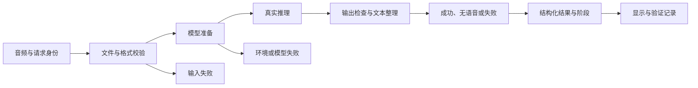
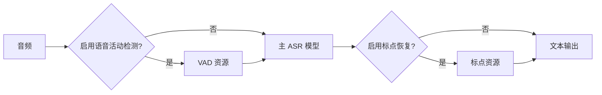

# AI 端侧工程师｜第二周专业知识自学清单

**学习主题：** 真实模型验证、连续推理、结构化结果与环境复现。

**建议周期：** 5 个工作日，与[第二周 AI 任务](../../task/02_第二次任务/AI端侧工程师.md)同步。

**前置基础：** 理解数字音频、ASR 输入输出和本地模型部署。

本文只讲通用知识，使用框架图与教学伪代码，不展示项目源码。伪代码省略推理库和 ROS 实现细节，不能直接运行；具体模型、参数和启动方法见任务书。

## 一、学习目标与总体框架

第一周解决“音频如何变成文字”，第二周解决“如何证明是真实推理、连续输入是否稳定、失败后是否说清楚、换机器能否复现”。已有功能应复用，学习不等于重新训练模型。



**图示注释：** 只有真正经过模型推理的录音结果才能证明真实识别；固定结果替身可以验证接口结构，不能验证模型准确率、性能和离线资源。

## 二、知识点讲解与注释

### 1. 环境、解释器与依赖锁定（重点）

同一机器可以有多个 Python 解释器，每个解释器的库和动态依赖可能不同。“能导入模型库”与“能导入机器人通信库”都需要在实际运行环境验证。

**理解注释：** 依赖锁定记录已经在目标系统验证过的版本与安装方式，不是随意冻结另一台机器的全部软件。深度学习运行库还与硬件、加速环境和系统库有关。

**任务观察：** 记录实际解释器、系统、硬件、模型库及推理运行库版本；解释为何使用不同终端环境会出现“安装过但导入失败”。

### 2. 模型加载、预热与复用（重点）

加载包括读取配置、权重和初始化资源；推理是对本段输入计算结果。每段重新加载通常增加开销，连续任务应在模型允许的使用方式下复用已加载实例。

```text
教学伪代码：模型管理
    模型实例初始为空

    准备模型：
        如果实例已经存在：返回实例
        检查配置、权重与所需资源
        开始计时
        加载模型；失败则返回明确加载错误
        记录加载耗时，保留实例

    处理音频：
        取得已准备模型
        单独计时本段推理  // 不把加载时间混成每段推理时间
        返回原始输出与实际耗时
```

**理解注释：** 首次推理可能涉及额外初始化，和后续耗时不同。服务能被发现不等于模型已加载，预加载报错后服务仍存在时尤其要区分。

### 3. 主模型、VAD 与标点依赖（重点）

语音链路可能由多个模型组成：主模型负责语音到文字，VAD 判断有效语音片段，标点模型整理断句。主模型位于本地不代表其他资源也能离线使用。



**图示注释：** 这是逻辑关系，不规定某个推理库的内部调用顺序。所有启用资源、配置和词表都要准备；断网验证要实际限制网络，而不是看到本地目录就宣称通过。

**任务观察：** 列出全部启用模型、资源位置和版本，记录断网启动及推理结果；禁用某项时解释影响。

### 4. 实际音频校验与输入失败（重点）

音频需要验证真实文件参数、非空、时长和可读性。空文件、合法静音、非语音噪声、损坏文件与错误格式是不同测试条件。

**理解注释：** 格式错误应在推理前拒绝；静音格式合法，但可能没有有效语音。声道与采样率转换需要处理真实样本，不能只改标签。输入失败与模型加载失败应给出不同原因。

```text
教学伪代码：输入检查
    检查文件是否在允许位置且可读
    解析实际音频头；解析失败则返回格式错误
    检查声道、采样率、采样位深
    检查帧数、时长是否在允许范围
    通过后进入推理  // “通过格式检查”仍不等于“包含语音”
```

### 5. 结构化结果、无语音与文本整理（重点）

业务结果应包括本次来源身份、状态、文字、时间和错误原因。没有抛异常不等于成功，空文字不能用默认答案补齐；模型对静音产生幻觉文字，也需要记录和处理。

**理解注释：** 文本整理可以移除无意义分隔符和规范空白，但不能把模型没有识别出的内容补成想要的答案。没有可信置信度就显示不可用，不填 100%。

```text
教学伪代码：构造本段结果
    复制输入的来源身份
    如果输入或模型失败：
        返回“失败”、明确原因、空成功文字
    否则检查真实模型输出：
        没有有效语音内容 → 返回“无语音”
        有有效内容 → 返回“成功”与实际文字
    记录完成时间和实际耗时
    发布本段结果与一致的阶段
    不读取上一段文字作为本段默认值
```

**任务观察：** 对两段内容不同的真实录音、静音和错误输入，分别核对结果状态、文字和来源，不能只展示一个成功样例。

### 6. 连续处理、并发与容量边界

连续处理是一次结束后还能处理下一次；并发是多个任务同时进行，两者不同。服务回调同步推理可能阻塞该执行器的其他回调，不能据此承诺可实时查询或取消。

**理解注释：** 第二周可采用单请求方案，忙碌时拒绝新输入并明确限制。后续增加工作线程、有界队列或独立进程时，还要处理模型线程安全、资源上限和退出，不是简单“加个线程”就完成。

**任务观察：** 保持同一模型进程连续处理两段，分别记录耗时；说明当前忙碌和恢复规则，不把顺序通过记为并发通过。

### 7. 超时、迟到结果与验证分层（重点）

接口等待超时不等于模型停止。迟到结果仍属于原请求；如果外部已经开始处理新请求，必须保留身份隔离，避免把旧文字当新成功。

**理解注释：** 逻辑测试、真实通信测试、真实模型测试、跨设备测试和断网加载分别证明不同能力，应该分开记录。模型替身适合稳定触发超时，却不能替代真实录音识别。

```text
教学伪代码：验证记录
    对每个场景记录：环境、版本、输入、来源身份、预期和实际结果
    明确标注：真实模型 / 固定结果替身
    明确标注：本机 / 跨设备 / 断网条件
    没有执行的场景标“待完成”
    失败后验证下一段合法输入能否恢复
```

## 三、五天学习与任务产物

| 时间 | 学习重点 | 在配套任务中形成的产物 |
|---|---|---|
| 第 1 天 | 解释器、依赖与模型资源 | 环境和资源清单 |
| 第 2 天 | 加载复用与真实推理 | 单段真实结果、版本记录 |
| 第 3 天 | 来源、连续处理与耗时 | 两段真实识别记录 |
| 第 4 天 | 静音、失败、断网与超时 | 异常和恢复结论 |
| 第 5 天 | 分层验证与复现 | 知识笔记和操作说明 |

## 四、自主研究与提交要求

1. 服务可发现、模型已加载、推理成功之间有什么区别？
2. 首次加载、首次推理和后续推理为什么要分别计时？
3. 主模型已下载，为什么断网后仍可能失败？
4. 空文件、静音、噪声和错误采样率分别验证什么？
5. 同一进程顺序完成两段为什么不能证明并发能力？
6. 如何说明固定模型替身测试的价值和限制？

笔记使用“自己的解释 → 图或伪代码 → 实际观察 → 尚存疑问 → 资料来源”。研发与通过条件见[岗位任务书](../../task/02_第二次任务/AI端侧工程师.md)和[共同记录模板](../../task/02_第二次任务/验收记录模板.md)。

## 五、参考资料

- [FunASR 官方说明](https://github.com/modelscope/FunASR)：了解模型加载、ASR、VAD 与标点能力，运行依赖采用实际验证版本。
- [Python 3.10：wave](https://docs.python.org/3.10/library/wave.html)：理解实际 WAV 参数读取。
- [Python 3.10：高精度计时](https://docs.python.org/3.10/library/time.html#time.perf_counter)：理解耗时测量。
