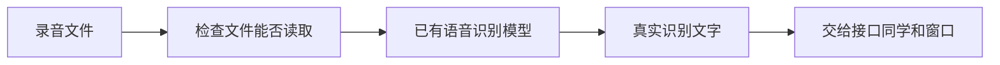

# AI 端侧工程师｜第二周专业知识自学清单

**适合对象：** 零基础成员。读完知识点，再跟着[本周任务](../../task/02_第二次任务/AI端侧工程师.md)做一步。

**本周目标：** 用已有识别程序，把两段不同的真实录音变成文字。

## 一、先看懂这张图



**图的意思：** 模型像一个已经学过听写的工具。你学习怎样把它启动、给它录音、查看结果，本周不用训练模型。

## 二、本周只学四个知识点

### 1. ASR 是什么？

ASR 就是语音识别：输入一段录音，输出文字。例如录音说“你好”，程序识别后得到“你好”。

**小注释：** 必须让模型真的处理录音。程序每次都返回预先写好的“你好”，只能用来演示，不能算真实识别。

### 2. WAV 是什么？

WAV 是一种音频文件格式。程序对采样率、声道和位深有要求；可以先把它们理解成录音的三个格式选项。

**本周记住：** 使用 16 kHz、单声道、16 位的短录音，每段建议 3～8 秒。

**小注释：** 不能把别的文件改名成 `.wav` 就当完成转换。先请接口同学一起确认文件格式，不要求本周自己编写转换工具。

### 3. 加载模型和识别录音有什么不同？

加载模型像先打开听写工具，识别录音像让工具开始听写。第一次启动可能要准备模型文件，等待时间会长一些。

**小注释：** 先沿用已经准备好的环境和模型。启动失败时记录报错，和负责人一起处理，不要一下安装或更换很多版本。

### 4. 什么时候算识别成功？

程序给出成功状态，并且得到与录音基本相符的真实文字，才算成功。没有声音、文件找不到、程序报错，都不能填一段默认文字当结果。

**小注释：** 第二份录音说不同的话，就应该得到对应的另一份文字。小的标点差异可以记录，不要求每个标点完全相同。

## 三、用伪代码理解工作顺序

下面只是中文步骤，不是项目代码，不用直接运行。

```text
启动已有识别程序，等待模型准备好
收到第一份录音后：
    检查文件能否读取
    让真实模型识别
    成功 → 交出本次文字和编号
    失败 → 说明原因，不填写假文字

第一份完成后，再处理第二份   // 不用每换一份文件就重启模型
```

## 四、只回答三个问题

1. ASR 的输入和输出分别是什么？
2. 为什么固定返回一句话不能算真实识别？
3. 文件找不到时，应该返回文字还是说明失败？

用自己的话写几句话即可。笔记和操作步骤合并成一份说明，具体完成要求见[岗位任务书](../../task/02_第二次任务/AI端侧工程师.md)。断网部署、版本锁定、模型性能比较和多任务同时处理以后再学，本周不考核。
