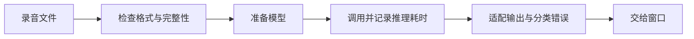
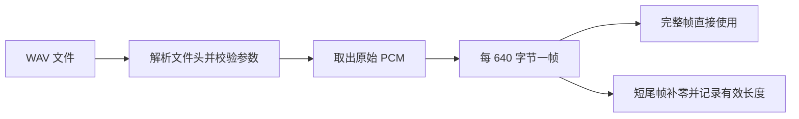

# AI 端侧工程师｜第二周专业知识自学清单

**学习目标：** 掌握音频完整性、PCM 分帧、模型输出适配与推理指标，配合[本周任务](../../task/02_第二次任务/AI端侧工程师.md)识别两份真实录音。

下面是独立编写的 Python 教学示例，不引用项目源码。每个代码块都能单独运行，使用 Python 标准库。标注 DEMO 的输出用于学习程序结构，不调用真实 ASR，不能代替任务中的真实录音验证。

## 一、识别流程框架



**图示说明：** 输入检查、模型准备、识别和结果整理是不同操作。某一步失败，要说明在哪一步失败。

## 二、知识点讲解

### 1. ASR 的输入与输出：用函数理解调用

ASR 把音频转成文字。函数有输入参数，也可以通过 `return` 返回结果，适合用来理解“给模型录音、取回文字”的过程。

```python
def demo_recognize(audio_name):
    # 教学演示：这里只整理字符串，没有读取音频、没有运行模型。
    return f"DEMO：收到文件名 {audio_name}"


text = demo_recognize("sample.wav")
print(text)
```

**注释：** `audio_name` 是参数，`text` 保存返回值。得到一个字符串不等于完成真实识别；任务中应由真实模型产生文字。

### 2. 文件检查：先确认音频在哪里

文件不存在或没有读取权限时，模型拿不到输入。`Path` 用来表示地址，`is_file()` 用来判断它是不是一个存在的文件。

```python
from pathlib import Path
from tempfile import TemporaryDirectory

with TemporaryDirectory() as folder:
    path = Path(folder) / "missing.wav"
    if path.is_file():
        print("可以继续读取文件")
    else:
        print("音频文件不存在，先检查输入路径")
```

**观察：** 本例特意没有创建文件，所以会走 `else` 分支。文件存在后，还需检查实际音频内容。

### 3. WAV 完整性：参数正确，还要检查数据是否够长

WAV 文件头保存声道、采样率和帧数等信息。一个音频帧包含各声道同一时刻的采样，因此 PCM 字节数应为 `帧数 × 声道数 × 每个采样的字节数`。文件头看起来正常，也可能缺少后面的数据。

```python
import io
import wave

buffer = io.BytesIO()
with wave.open(buffer, "wb") as audio:
    audio.setnchannels(1)
    audio.setsampwidth(2)
    audio.setframerate(16000)
    audio.writeframes(b"\x00\x00" * 16000)  # 一秒静音，非真实语音

wav_bytes = buffer.getvalue()
for name, data in [("完整文件", wav_bytes), ("截断文件", wav_bytes[:-100])]:
    with wave.open(io.BytesIO(data), "rb") as audio:
        frames = audio.getnframes()
        expected = frames * audio.getnchannels() * audio.getsampwidth()
        pcm = audio.readframes(frames)
        duration = frames / audio.getframerate()
        print(name, "时长：", duration, "完整：", len(pcm) == expected)
```

**观察：** 完整文件为 `True`，截断文件为 `False`。本例展示数据区被截断的情形；严重损坏的文件也可能直接抛出 `wave.Error` 或 `EOFError`。读出时长不能代替完整性检查。

### 4. 模型复用：准备一次，调用多次

模型加载像先打开听写工具，推理像让工具听写一份录音。连续识别时，通常先准备模型，再重复调用，避免每段都重新加载。

```python
class DemoRecognizer:
    def __init__(self):
        # __init__ 在创建对象时执行一次。
        print("DEMO：创建识别工具")

    def recognize(self, audio_name):
        # 这里只模拟调用，不加载权重，也不识别音频。
        return f"DEMO 调用：{audio_name}"


model = DemoRecognizer()  # 创建一个对象，保存在 model 中
print(model.recognize("a.wav"))
print(model.recognize("b.wav"))  # 继续使用同一个对象
```

**观察：** 创建提示出现一次，调用提示出现两次。`class` 定义一类工具，`self` 代表正在使用的这个对象；实际模型仍沿用任务中已准备的工具。

### 5. 模型输出适配：统一结构，并区分空结果与错误结构

不同工具可能返回字符串、字典或分段列表。先根据选定工具的返回约定写适配层，把业务侧统一为文字；结构不符合约定要报错，不能悄悄当成无语音。

```python
def normalize_segments(raw):
    # 本例只接受 [{"text": "..."}, ...]，不是所有 ASR 工具的通用格式。
    if not isinstance(raw, list):
        raise TypeError("模型结果应为分段列表")
    parts = []
    for item in raw:
        if not isinstance(item, dict) or not isinstance(item.get("text"), str):
            raise TypeError("每段必须包含字符串 text")
        cleaned = item["text"].strip()
        if cleaned:
            parts.append(cleaned)
    return " ".join(parts)  # 分段之间用空格，具体拼接规则按业务约定


for raw in [[{"text": " DEMO 第一段 "}, {"text": "第二段"}], [], [{"text": 123}]]:
    try:
        text = normalize_segments(raw)
        print("文字：", text, "状态：", "SUCCESS" if text else "EMPTY_TEXT")
    except TypeError as error:
        print("输出格式错误：", error)
```

**注释：** `EMPTY_TEXT` 只表示未得到文字，不足以证明录音没有语音。原始返回值可在调试时保留，实际状态映射按后端契约处理。

### 6. 错误与结果：失败原因也要带回去

一个结果可以包含编号、成功与否、文字和说明。编号让结果对应输入，异常处理让调用失败时仍有明确原因。本节传入的 `recognize` 约定返回字符串；若真实工具返回分段列表，应先用上一节的适配函数转成文字。

```python
def run_once(request_id, audio_name, recognize):
    try:
        text = recognize(audio_name)
    except RuntimeError as error:
        return {"request_id": request_id, "success": False,
                "text": "", "message": str(error)}
    return {"request_id": request_id, "success": bool(text.strip()),
            "text": text.strip(), "message": "调用已返回"}


def broken_recognizer(audio_name):
    raise RuntimeError("DEMO：模型没有准备好")


result = run_once("demo-001", "a.wav", broken_recognizer)
print(result["success"])
print(result["message"])
```

**观察：** 输出 `False` 和错误原因，不会拿上次文字补本次结果。这里的字典与字符串状态是教学表示，实际输出按任务书中的正式类型处理。

### 7. PCM 幅度分析：计算 RMS 与 dBFS

峰值反映最大幅度，RMS 是采样平方的平均值再开平方，用于观察整体能量。对于本例有符号 16 位 PCM，除以 `32768` 可得到相对满刻度的 RMS，再用 `20 × log10()` 转为 dBFS。

```python
import math
import struct

samples = [0, 1000, -1000, 2000, -2000, 0]
pcm = struct.pack("<6h", *samples)  # 小端、有符号 16 位；演示数据非语音
values = struct.unpack(f"<{len(pcm) // 2}h", pcm)
peak = max(abs(value) for value in values)
rms = math.sqrt(sum(value * value for value in values) / len(values))
dbfs = 20 * math.log10(rms / 32768) if rms > 0 else float("-inf")
print("峰值：", peak)
print(f"RMS：{rms:.2f}，dBFS：{dbfs:.2f}")
print("是否全零：", all(value == 0 for value in values))
```

**观察：** 峰值为 `2000`，RMS 大于零，dBFS 为负值。全零输入可判为数字静音；RMS 阈值依赖设备与环境，不能把固定阈值直接当作可靠的语音检测。

### 8. 定长音频帧：把 PCM 按时间切成小段

单声道 16 kHz 音频的 20 ms 对应 `16000 × 0.02 = 320` 个采样，16 位采样每个占两字节，所以一帧占 640 字节。短尾帧可以补零，但必须同时记录原始有效长度。



```python
def split_frames(pcm, sample_rate=16000, frame_ms=20):
    if len(pcm) % 2:
        raise ValueError("16 位 PCM 字节数必须是 2 的倍数")
    if sample_rate <= 0 or frame_ms <= 0:
        raise ValueError("采样率和帧长必须为正数")
    samples = sample_rate * frame_ms / 1000
    if not samples.is_integer():
        raise ValueError("帧长必须对应整数个采样")
    frame_bytes = int(samples) * 2  # 本例固定单声道、16 位 PCM
    for offset in range(0, len(pcm), frame_bytes):
        chunk = pcm[offset:offset + frame_bytes]
        valid_bytes = len(chunk)
        yield chunk.ljust(frame_bytes, b"\x00"), valid_bytes


pcm = b"\x01\x00" * 500  # 500 个演示采样，分成两帧
frames = list(split_frames(pcm))
print([(len(frame), valid) for frame, valid in frames])
print("原始有效采样数：", sum(valid for _, valid in frames) // 2)
```

**观察：** 两帧均为 640 字节，有效长度分别为 640、360。补零不是原始内容；分帧也不等于流式识别，模型是否支持流式输入需要另行确认。WAV 文件头不能当作 PCM 采样送入本函数。

### 9. 推理计时与 RTF：按音频时长解释速度

本节按“推理耗时 ÷ 音频时长”计算实时率 RTF（[NVIDIA 的测量说明](https://developer.nvidia.com/blog/pushing-the-boundaries-of-speech-recognition-with-nemo-parakeet-asr-models/)）。例如处理 2 秒音频用了 0.5 秒，RTF 为 0.25。加载模型应单独计时；不同设备、时长和预热条件下的数据不能直接混在一起比较。

```python
from time import perf_counter


def measure(infer, pcm, duration_s):
    if duration_s <= 0:
        raise ValueError("音频时长必须大于零")
    started = perf_counter()
    raw = infer(pcm)
    elapsed = perf_counter() - started
    return {"raw": raw, "infer_s": elapsed, "rtf": elapsed / duration_s}


def demo_infer(pcm):
    # 只模拟接口返回，不加载模型，所以计时不能代表 ASR 性能。
    return [{"text": f"DEMO：收到 {len(pcm)} 字节"}]


result = measure(demo_infer, b"\x00\x00" * 32000, duration_s=2.0)
print(f"调用耗时：{result['infer_s']:.6f} 秒，RTF：{result['rtf']:.6f}")
print("算式练习：", 0.5 / 2.0)
```

**注释：** 这里测的是演示函数。真实记录应包含硬件、模型、音频时长、是否预热；RTF 也不包含传输、排队和窗口显示的全部延迟。

### 10. 差异定位：指出漏字、插字和替换位置

只看两句话是否完全相同，无法知道哪里出错。`SequenceMatcher` 可以对齐两段文字，给出相等、替换、删除、插入等片段，适合人工排查识别结果。

```python
from difflib import SequenceMatcher

expected = "今天开始学习"
actual = "今天开始学"
matcher = SequenceMatcher(None, expected, actual, autojunk=False)
for tag, i1, i2, j1, j2 in matcher.get_opcodes():
    if tag != "equal":
        print("差异类型：", tag)
        print("原文片段：", repr(expected[i1:i2]))
        print("识别片段：", repr(actual[j1:j2]))
```

**观察：** 输出删除片段“习”，识别片段为空。这个工具便于展示差异，其匹配算法不是计算最小编辑距离的 CER 算法；标点、空格和数字怎样处理也要先统一，保留原始模型结果便于复查。

## 三、组合示例：检查音频、复用工具、返回独立结果

下面把输入校验、PCM 检查、工具复用和错误分类组合起来。音频在内存中合成，`DemoEngine` 返回固定教学文字；运行结果用于练习流程，不表示真正识别了语音。

```python
import io
import wave
from time import perf_counter


class DemoEngine:
    def __init__(self):
        self.calls = 0  # 同一个工具处理多份输入

    def recognize(self, pcm):
        self.calls += 1
        return [{"text": f"DEMO 第 {self.calls} 次工具调用"}]


def run_audio(request_id, wav_bytes, engine):
    started = perf_counter()
    result = {"request_id": request_id, "success": False, "text": "",
              "code": "INVALID_AUDIO", "message": "", "duration_s": 0.0}
    try:
        with wave.open(io.BytesIO(wav_bytes), "rb") as audio:
            if (audio.getframerate(), audio.getnchannels(), audio.getsampwidth()) != (16000, 1, 2):
                raise ValueError("要求 16 kHz、单声道、16 位 PCM")
            frames = audio.getnframes()
            pcm = audio.readframes(frames)
            if frames == 0 or len(pcm) != frames * 2:
                raise ValueError("音频为空或数据不完整")
            result["duration_s"] = frames / 16000
    except (wave.Error, EOFError, ValueError) as error:
        result["message"] = str(error)
    else:
        if not any(pcm):  # 本例只拦截全零 PCM，不做通用语音检测
            result.update(code="ZERO_PCM", message="全零采样，跳过工具调用")
        else:
            try:
                raw = engine.recognize(pcm)
                if not isinstance(raw, list) or any(
                    not isinstance(item, dict) or not isinstance(item.get("text"), str)
                    for item in raw
                ):
                    raise TypeError("返回结构不符合约定")
                text = " ".join(item["text"].strip() for item in raw).strip()
                result.update(success=bool(text), text=text,
                              code="SUCCESS" if text else "EMPTY_TEXT", message="工具已返回")
            except (RuntimeError, TypeError) as error:
                result.update(code="MODEL_ERROR", message=str(error))
    result["elapsed_s"] = perf_counter() - started
    return result


def make_wav(pcm):
    buffer = io.BytesIO()
    with wave.open(buffer, "wb") as audio:
        audio.setnchannels(1)
        audio.setsampwidth(2)
        audio.setframerate(16000)
        audio.writeframes(pcm)
    return buffer.getvalue()


engine = DemoEngine()
signal = make_wav(b"\x10\x00" * 1600)  # 合成非零采样，不是语音
cases = [("a", signal), ("b", signal),
         ("silent", make_wav(b"\x00\x00" * 1600)), ("bad", b"not a WAV")]
results = [run_audio(request_id, data, engine) for request_id, data in cases]
for result in results:
    print(result["request_id"], result["code"], result["text"])
print("工具调用次数：", engine.calls)
```

**动手改一改：** 让 `recognize()` 返回空列表、错误结构或抛出 `RuntimeError`，分别观察 `EMPTY_TEXT` 和 `MODEL_ERROR`。再把 WAV 数据截短，检查是否在工具调用之前被拒绝。

## 四、思考与练习

1. WAV 参数正确但数据被截断时，怎样在模型调用前发现？
2. 空文字、全零 PCM、返回结构错误三者有什么区别？
3. 两段不同时长的音频，为什么不能只比较推理秒数？RTF 又缺少哪些延迟？

将自己的解释、示例输出和任务操作步骤合并为一份说明。本节先练习计时和差异定位；正式性能基准、模型量化和并行推理放到后续学习。

## 五、参考资料

- [Python：wave 音频文件](https://docs.python.org/3.10/library/wave.html)。
- [Python：类与对象](https://docs.python.org/3.10/tutorial/classes.html)。
- [Python：二进制采样读写](https://docs.python.org/3.10/library/struct.html)。
- [Python：耗时测量](https://docs.python.org/3.10/library/time.html#time.perf_counter)。
- [Python：数学函数](https://docs.python.org/3.10/library/math.html)。
- [Python：文本差异对齐](https://docs.python.org/3.10/library/difflib.html)。
- [NVIDIA：RTF 的定义与测量场景](https://developer.nvidia.com/blog/pushing-the-boundaries-of-speech-recognition-with-nemo-parakeet-asr-models/)。
- [Audacity：RMS 测量](https://manual.audacityteam.org/man/contrast.html)。
