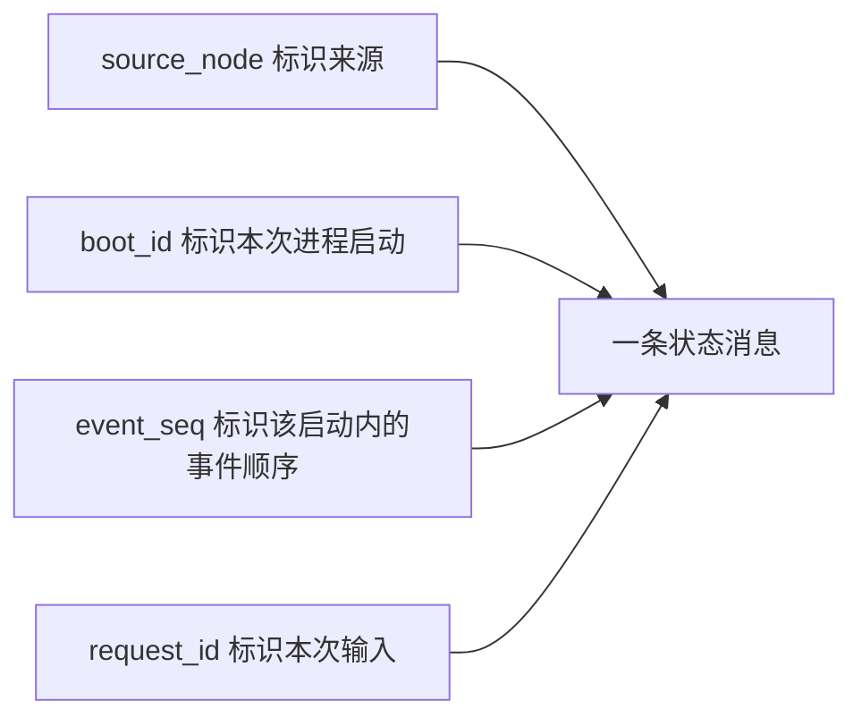

# AI 端侧工程师｜第二周专业知识自学清单

**学习目标：** 看懂项目如何检查 WAV、复用 FunASR 模型、整理文字并发布结构化结果，配合[本周任务](../../task/02_第二次任务/AI端侧工程师.md)识别两份真实录音。

本页取自第一次任务后参考项目中的 `FunAsrEngine`、`probe_wav()`、`normalize_text()` 和 `ASRNode`，代码直接内嵌。保留项目实际的文件输入、模型名和消息状态，不混入另一套模型后端。片段删去了部分日志、参数声明和初始化，带 `self` 的方法需要原对象上下文；真实推理片段还需要模型和依赖。第三节明确使用测试替身，只验证处理流程。

## 一、项目识别流程


**阅读重点：** 当前参考项目使用 `paraformer-zh`，可配置 VAD 和标点模型。文件校验、模型推理、结果发布各自负责一段逻辑；返回空文字与抛出异常走不同分支。

## 二、知识点讲解

### 1. 模型参数：本地目录优先于模型名

**取自：** `FunAsrEngine.__init__()`，只保留模型选择与复用所需字段。默认值让组员先运行已有方案，同时保留替换模型来源的入口。

```python
class FunAsrEngine:
    def __init__(self, model="paraformer-zh", model_path="", device="cpu"):
        self.model = model_path.strip() if model_path else model.strip()
        if not self.model:
            raise ValueError("model 和 model_path 不能同时为空")
        self.device = device or "cpu"
        self.auto_model = None  # 以后保存加载后的真实模型
        self.load_seconds = 0.0


engine = FunAsrEngine(model_path="/example/local-model")
print(engine.model)  # 这里只查看配置，不加载或下载模型
```

**理解：** `model_path` 的选择不会自动验证目录完整，也不能证明模型已经加载。项目完整构造器还包含缓存、VAD、标点和日志选项。

### 2. WAV 探测：从实际文件读取元信息

**取自：** 项目的 `probe_wav()`，补充中文注释，保留实际返回字段。

```python
import wave


def probe_wav(path):
    with wave.open(path, "rb") as audio_file:
        channels = audio_file.getnchannels()
        sample_rate = audio_file.getframerate()
        bit_depth = audio_file.getsampwidth() * 8  # 字节转为位
        duration = audio_file.getnframes() / float(sample_rate) if sample_rate else 0.0
    return {"channels": channels, "sample_rate": sample_rate,
            "bit_depth": bit_depth, "duration": duration}
```

**理解：** `with` 结束后文件关闭。此函数读取 WAV 头，不检查所有采样数据是否完整，也不检测是否有语音；不要把它当成完整音频质量校验。

### 3. 调用前校验：路径、格式与时长分别判断

**取自：** `ASRNode.handle_recognize()` 的输入校验，抽成函数；调用上一节的 `probe_wav()`。`max_audio_seconds` 对应节点参数，参考默认值为 300 秒。

```python
from pathlib import Path


def validate_request(request, max_audio_seconds=300.0):
    if not request.request_id:
        raise ValueError("request_id is required")
    path = Path(request.audio_path).expanduser()
    if not request.audio_path or not path.is_absolute():
        raise ValueError("audio_path must be absolute on the AI host")
    if not path.is_file():
        raise FileNotFoundError(str(path))
    info = probe_wav(str(path))
    if (info["sample_rate"], info["channels"], info["bit_depth"]) != (16000, 1, 16):
        raise ValueError("Expected 16000 Hz mono 16-bit PCM WAV")
    if not 0 < info["duration"] <= max_audio_seconds:
        raise ValueError("Audio duration is empty or exceeds configured limit")
    return path  # 教学封装增加返回值，供后续调用使用
```

**理解：** 这是 AI 主机可读取的绝对路径；另一台机器上的同名地址并不自动可用。改扩展名不能把其他音频转成合格 WAV。

### 4. 加载与复用：auto_model 不为空就直接使用

**取自：** `FunAsrEngine.load()` 的核心部分。删去缓存设置、日志和旧版本兼容重试，仅保留加载、选项和计时；需要完整对象上的 VAD、标点字段。

```python
import time


def load(self):
    if self.auto_model is not None:
        return self.auto_model  # 第二次调用不再创建模型
    from funasr import AutoModel
    kwargs = {"model": self.model, "device": self.device, "disable_update": True}
    if self.use_vad and self.vad_model:
        kwargs["vad_model"] = self.vad_model
    if self.use_punc and self.punc_model:
        kwargs["punc_model"] = self.punc_model
    started = time.perf_counter()
    self.auto_model = AutoModel(**kwargs)  # ** 将字典展开成关键字参数
    self.load_seconds = time.perf_counter() - started
    return self.auto_model
```

**理解：** 复用的是模型对象，不是上一次的识别文字。这里没有实际执行加载示范；真实模型是否就绪需以运行环境为准。

### 5. 模型推理：整理调用参数并单独计时

**取自：** `FunAsrEngine.recognize()`，删去空结果日志。`normalize_text()` 与 `_first_text()` 在后两节展开。

```python
import os
import time


def recognize(self, audio_path, batch_size_s=300.0, hotword=""):
    if not os.path.exists(audio_path):
        raise FileNotFoundError(f"音频文件不存在: {audio_path}")
    model = self.load()
    kwargs = {"input": audio_path, "batch_size_s": float(batch_size_s)}
    if hotword:
        kwargs["hotword"] = hotword
    started = time.perf_counter()
    result = model.generate(**kwargs)
    elapsed = time.perf_counter() - started
    text = normalize_text(self._first_text(result))
    return text, elapsed
```

**理解：** 模型输入是文件路径，返回值是 `(文字, 推理秒数)`。`batch_size_s` 是推理配置，不等于节点的最大录音时长校验；这里计时不包含前面的模型加载。

### 6. 返回结构提取：递归处理分段结果

**取自：** `FunAsrEngine._first_text()`，改为同名独立函数，递归调用随之改名。递归指函数遇到列表时，再处理其中每一项。

```python
def _first_text(result):
    if not result:
        return ""
    if isinstance(result, (list, tuple)):
        return "".join(_first_text(item) for item in result)
    if isinstance(result, dict):
        return str(result.get("text", ""))
    return str(result)


raw = [{"text": "你 好"}, {"text": "，欢 迎"}]
print(_first_text(raw))
print(repr(_first_text([])))
```

**理解：** 项目这里采用宽松兼容，例如数字也可能被转成字符串；它不是严格的模型输出结构校验器。不要把“能提取文字”理解成“输出语义一定正确”。

### 7. 文本规范化：清理分隔空格，保留原意

**取自：** `normalize_text()` 与其正则定义，保留项目清理顺序。正则表达式用于匹配某一类文本，这里重点观察中文空格与英文数字空格的区别。

```python
import re

_CJK = r"[\u3000-\u303f\u3400-\u4dbf\u4e00-\u9fff\uf900-\ufaff\uff00-\uffef]"
_CJK_SPACE = re.compile(rf"(?<={_CJK})[ \t\u2581]+(?={_CJK})")
_MULTI_SPACE = re.compile(r"[ \t]{2,}")
_SPELL_ACRONYM = re.compile(r"(?<![A-Za-z])(?:[A-Za-z] )+(?=[A-Za-z](?![A-Za-z]))")


def normalize_text(text):
    text = text.replace("\u2581", "")
    text = _CJK_SPACE.sub("", text)
    text = _SPELL_ACRONYM.sub(lambda match: match.group().replace(" ", ""), text)
    text = _MULTI_SPACE.sub(" ", text)
    return text.strip()


print(normalize_text("你 好，欢 迎使用 R O S 2"))
```

**观察：** 中文字间空格被去除，拼读缩写变成 `ROS 2`。这是项目的启发式规则，可能把 `A B is fine` 中的 `A B` 合并；应对照录音检查，不能将规则改成补写预设答案。

### 8. 结果契约：空文字与成功使用不同状态

**取自：** `ASRNode.handle_recognize()` 的结果构造和成功分支，抽成返回结果与阶段的函数。时间戳赋值和发布放在完整节点中处理。

```python
from robot_interfaces.msg import AudioProcessingState, RecognizedText


def make_result(request, text):
    result = RecognizedText()
    for name in ("request_id", "session_id", "segment_id", "input_context_id",
                 "capture_started_at", "capture_ended_at"):
        setattr(result, name, getattr(request, name))
    result.confidence = -1.0  # 项目约定：没有可用置信度
    result.language = "zh"
    result.text = text
    result.success = bool(text.strip())
    result.status = RecognizedText.SUCCESS if result.success else RecognizedText.NO_SPEECH
    result.message = "Recognition completed" if result.success else "No speech recognized"
    stage = (AudioProcessingState.ASR_COMPLETED if result.success
             else AudioProcessingState.NO_SPEECH)
    return result, stage
```

**理解：** `RecognizedText.status` 与 `AudioProcessingState.stage` 是两组常量，例如成功状态值与完成阶段值并不相同。`NO_SPEECH` 是项目对空文字的状态约定，不能证明音频物理上完全静音。

### 9. 异常映射：失败时保留本次编号和错误码

**取自：** `ASRNode.handle_recognize()` 的异常分类，抽成练习函数。调用前已创建属于本次请求的 `result` 并设为失败，`operation` 代表待执行的校验或推理动作。

```python
def run_with_errors(operation, result):
    try:
        return operation()
    except FileNotFoundError as error:
        result.error_code = "AUDIO_NOT_FOUND"
        result.message = str(error)
    except (ValueError, EOFError) as error:
        result.error_code = "INVALID_AUDIO_REQUEST"
        result.message = str(error)
    except Exception as error:
        result.error_code = "ASR_FAILED"
        result.message = str(error)
    return None
```

**理解：** 保留项目现有分类：例如 `wave.Error` 会落入最后一类，而不是自动成为 `INVALID_AUDIO_REQUEST`。这也是阅读实际实现时要发现的边界；不要把教学时希望有的精细分类说成已有能力。

### 10. 事件身份：source_node、boot_id 与 event_seq

**取自：** `ASRNode.publish_state()`，补充注释。`boot_id` 在节点启动时生成，`event_seq` 从零开始递增。

```python
from robot_interfaces.msg import AudioProcessingState


def publish_state(self, request, stage, message="", error_code=""):
    state = AudioProcessingState()
    state.stamp = self.get_clock().now().to_msg()
    state.source_node = self.get_fully_qualified_name()
    state.boot_id = self.boot_id
    self.event_seq += 1
    state.event_seq = self.event_seq
    for name in ("request_id", "session_id", "segment_id", "input_context_id", "audio_path"):
        setattr(state, name, getattr(request, name))
    state.operation = "/ai/recognize_audio"
    state.stage = stage
    state.message = message
    state.error_code = error_code
    self.status_pub.publish(state)
```



**理解：** 节点重启后序号会重新开始，因此不能只按 `event_seq` 比大小；显示端需要连同来源和启动编号判断。音频处理完成也不代表机器人已执行动作。

## 三、组合示例：按项目分支处理两份输入

从 `handle_recognize()` 裁剪：保留 WAV 参数校验、编号、空文字分支和错误码。为便于独立练习，ROS 结果改为字典，真实 `FunAsrEngine` 改为返回预设内容的测试替身，省略 Topic 发布与完整元数据。这个脚本只验证分支，不是实际 ASR 验收。

```python
import wave
from pathlib import Path
from tempfile import TemporaryDirectory


def probe_wav(path):
    with wave.open(str(path), "rb") as audio_file:
        return {"sample_rate": audio_file.getframerate(),
                "channels": audio_file.getnchannels(),
                "bit_depth": audio_file.getsampwidth() * 8,
                "duration": audio_file.getnframes() / audio_file.getframerate()}


class EngineStub:
    def __init__(self):
        self.outputs = iter(["DEMO 第一份文字", ""])

    def recognize(self, path):
        return next(self.outputs), 0.0  # 固定替身输出，没有加载模型


def handle_recognize(request_id, path, engine):
    result = {"request_id": request_id, "success": False, "status": "FAILED",
              "text": "", "error_code": "", "message": ""}
    try:
        if not request_id or not path.is_absolute():
            raise ValueError("需要编号与绝对路径")
        if not path.is_file():
            raise FileNotFoundError(str(path))
        info = probe_wav(path)
        if (info["sample_rate"], info["channels"], info["bit_depth"]) != (16000, 1, 16):
            raise ValueError("Expected 16000 Hz mono 16-bit PCM WAV")
        if not 0 < info["duration"] <= 300:
            raise ValueError("Audio duration is empty or exceeds configured limit")
        text, elapsed = engine.recognize(str(path))
        result.update(text=text, success=bool(text.strip()),
                      status="SUCCESS" if text.strip() else "NO_SPEECH")
    except FileNotFoundError as error:
        result.update(error_code="AUDIO_NOT_FOUND", message=str(error))
    except (ValueError, EOFError) as error:
        result.update(error_code="INVALID_AUDIO_REQUEST", message=str(error))
    except Exception as error:
        result.update(error_code="ASR_FAILED", message=str(error))
    return result


with TemporaryDirectory() as folder:
    paths = [Path(folder) / "a.wav", Path(folder) / "b.wav"]
    for path in paths:
        with wave.open(str(path), "wb") as audio:
            audio.setnchannels(1)
            audio.setsampwidth(2)
            audio.setframerate(16000)
            audio.writeframes(b"\x00\x00" * 1600)  # 合成静音，仅作格式样本
    engine = EngineStub()
    results = [handle_recognize(f"demo-{i}", path, engine)
               for i, path in enumerate(paths, start=1)]
    results.append(handle_recognize("missing", Path(folder) / "missing.wav", engine))
    for result in results:
        print(result["request_id"], result["status"], result["text"], result["error_code"])
```

**动手改一改：** 将第二个 WAV 的采样率改为 8000，观察它是否在推理前被拒绝。替身即使对静音返回文字，也不能证明模型识别有效；真实效果必须换回真实引擎并使用真实录音。

## 四、思考与练习

1. 为什么 `recognize()` 每次调用 `load()`，模型仍只创建一次？
2. `status` 与 `stage`、`request_id` 与 `boot_id` 分别解决什么问题？
3. 现有 `probe_wav()` 与 `_first_text()` 还没有严格检查哪些情况？

把自己的解释和实际任务结果记在同一份说明里。代码片段用于读懂已有实现，不要求本周重做模型封装或扩展状态协议。

## 五、参考资料

- [Python：wave 音频文件](https://docs.python.org/3.10/library/wave.html)。
- [Python：正则表达式](https://docs.python.org/3.10/library/re.html)。

项目函数与关键代码已内嵌，来源使用名称说明，不设置源码跳转链接。
