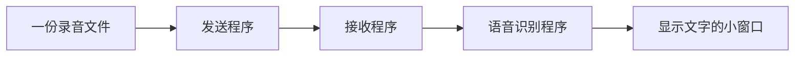

# 接口调用工程师｜第二周专业知识自学清单

**适合对象：** 零基础成员。读完知识点，再跟着[本周任务](../../task/02_第二次任务/接口调用工程师.md)做一步。

**本周目标：** 把一份录音文件交给识别程序，再把识别结果交给窗口。先用好已有程序。

## 一、先看懂这张图



**图的意思：** 你主要负责中间的“发送、接收和交给下一位”。识别模型由 AI 同学负责，窗口由可视化同学负责。

## 二、本周只学四个知识点

### 1. 什么是文件路径？

路径就是文件的地址。例如 `/home/student/audio/a.wav` 表示一份文件放在哪里。

**小注释：** AI 程序需要能读到这个文件。文件在另一台电脑上，即使路径写得一样，也不代表已经传过来了。

**做一做：** 找到一份录音，写下它的完整路径，再确认接收端保存到了哪里。

### 2. 什么是发送和接收？

发送程序负责把文件交出去，接收程序负责把文件收下来。这就像寄快递：寄出和收到是两件事。

**小注释：** 看到“发送结束”，还要检查接收端是否真的保存了文件。本周一次只发一份短录音，等它识别完成再发下一份。

**做一做：** 发一份录音，检查接收文件；再发另一份内容不同的录音。

### 3. Topic 和 Service 是什么？

- **Topic（话题）：** 像公告栏，程序把状态和文字发出来，其他程序接收。
- **Service（服务）：** 像问一次问题，得到一次回答，例如请识别程序处理某个文件。

**小注释：** 本周沿用已有的发送、调用和转发程序。先知道数据去向，不要求从头编写通信系统。

### 4. 什么是请求编号？

每次识别有一个编号，就像快递单号，用来确认“这条文字属于哪份录音”。程序中的名字是 `request_id`。

**小注释：** 转交结果时保留原编号。两段录音的结果不能混在一起；等待太久也先别反复发送，找 AI 同学一起检查。

## 三、用伪代码理解工作顺序

下面只是中文步骤，不是项目代码，不用直接运行。

```text
先启动接收程序
发送第一份录音
检查文件是否收到          // 寄出不等于收到
等待 AI 给出第一份文字
记下编号和文字

第一份完成后，再发送第二份
检查第二份编号和文字      // 不要拿第一份文字充当第二份结果
```

## 四、只回答三个问题

1. “文件发出去了”和“文件收到了”有什么不同？
2. 为什么两段录音要有不同编号？
3. 窗口没有文字时，你先找哪位同学、检查哪一步？

用自己的话写几句话即可。笔记和操作步骤合并成一份说明，具体完成要求见[岗位任务书](../../task/02_第二次任务/接口调用工程师.md)。分块校验、队列、复杂超时处理以后再学，本周不考核。
