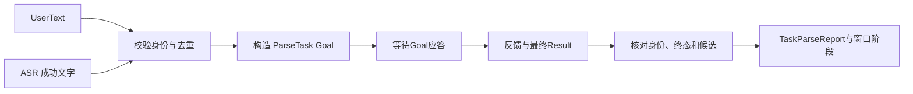
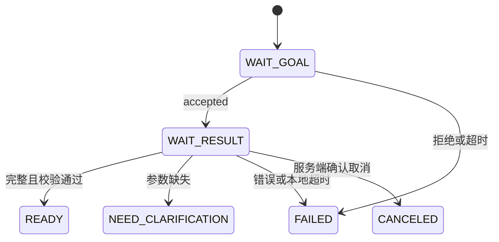

# 接口调用工程师｜第二周专业知识自学清单

**学习目标：** 在第一周文件收发与 ASR 转发上，掌握文字/语音入口、ParseTask Action、结果关联、去重、超时取消与类型化报告，配合[本周任务](../../task/02_第二次任务/接口调用工程师.md)新增语义桥接。

片段来自当前项目 `ConversationClient`、`AudioPipeline`、`AudioJobQueue`、结果校验器与 `AudioVisualization`，并注明本周裁剪。参考项目需新增 `semantic_bridge`，这些片段不是已存在于参考项目的完整节点。带 `self` 的方法需要对象上下文，ROS 类型与部分校验函数由原模块提供；代码直接内嵌，不跳转源码。

## 一、双入口与结果链



文件收发继续复用，不在接口层部署 LLM 或改写识别内容。本周复杂度主要来自异步生命周期，而不是再写一遍录音发送。

## 二、知识点讲解

### 1. 入口筛选：正常失败与矛盾字段分开

**取自：** `ConversationClient.send()` 与 `validate_asr_result()` 的文字/成功检查，裁剪为函数；省略完整音频来源与时间戳核验。正常的失败不调用 LLM，字段矛盾应报错。

```python
def text_input(value):
    text = value["text"].strip()
    if not text or len(text) > 4096:
        raise ValueError("请输入1至4096字的内容")
    return text


def asr_input(result):
    if result.success and result.status == result.SUCCESS and result.text.strip():
        return result.text  # 保留真实 ASR 文字，不改成预设句子
    if not result.success and result.status in (result.NO_SPEECH, result.FAILED) and not result.text:
        return None
    raise ValueError("ASR 状态、成功标志与文字相互矛盾")
```

**理解：** 这段只说明文字筛选，实际桥接还要检查身份、长度与本轮契约，不能单靠一个 `if success`。

### 2. Goal 构造：输入来源和解析请求关联

**取自：** `AudioPipeline.build_parse_goal()` 的单轮部分，参数化白名单；省略续轮历史。本例处理语音来源，直接文字对应项目 `ConversationClient.send()` 的 `text:<request_id>`。

```python
from robot_interfaces.action import ParseTask


def build_parse_goal(self, msg, text, stations, objects):
    goal = ParseTask.Goal()
    goal.stamp = self.node.get_clock().now().to_msg()
    goal.request_id, goal.session_id = msg.request_id, msg.session_id
    goal.input_id = "audio:" + msg.segment_id
    goal.input_context_id, goal.text = msg.input_context_id, text
    goal.allowed_station_ids = list(stations)
    goal.allowed_object_ids = list(objects)
    return goal  # context 与 partial_candidate 保持默认空值
```

**理解：** 同一语音输入保留来源编号，不在每一跳重新生成请求 ID。白名单随 Goal 传递，结果校验不能使用比提交时更宽的集合。

### 3. 发起 Goal：保存 Future 和阶段

**取自：** `ConversationClient.send()` 的异步提交部分，封装为方法并省略校验。调用者已确认服务就绪；完整任务还需实现最多3秒的非阻塞服务发现等待。

```python
import time


def send_goal(self, goal):
    future = self.node.parser.send_goal_async(goal)
    self.active = dict(
        request_id=goal.request_id, goal=goal, future=future,
        stage="goal", deadline=time.monotonic() + 3.0,
    )
```

**理解：** 返回 Future 不是模型已接受或已完成。`active` 保存本次上下文，不能被第二条输入覆盖；服务发现和忙碌门控要在进入这个片段前处理。

### 4. Goal 应答：接受后才请求最终结果

**取自：** `ConversationClient.poll()` 的 Goal 分支，省略外层异常处理。本周结果等待使用70秒，代替完整项目的配置默认值。

```python
import time


def advance_goal(self):
    job = self.active
    if job["stage"] != "goal" or not job["future"].done():
        return
    handle = job["future"].result()
    if not handle.accepted:
        raise RuntimeError("PARSE_GOAL_REJECTED：语义服务拒绝请求")
    job.update(handle=handle, future=handle.get_result_async(), stage="result",
               deadline=time.monotonic() + 70.0)
```

**理解：** Goal 拒绝后不会有正常的自定义 Result。完整客户端应发布一次失败并清理 active；AI 的 `/ai/request_status` 可提供更明确的拒绝原因。

### 5. Result 核验：身份、Action 终态与业务结果一起检查

**取自：** `validate_parse_result()` 的身份与 READY 检查，候选校验作为注入函数；本段仅演示 READY 分支，其他终态按共同任务表补全。

```python
from action_msgs.msg import GoalStatus
from robot_interfaces.action import ParseTask


def validate_ready(goal, wrapped, check_candidate):
    result = wrapped.result
    fields = ("request_id", "session_id", "input_id", "input_context_id")
    if any(getattr(result, name) != getattr(goal, name) for name in fields):
        raise ValueError("PARSE_RESULT_MISMATCH")
    ready = (wrapped.status == GoalStatus.STATUS_SUCCEEDED
             and result.success and result.outcome == ParseTask.Result.READY
             and not result.error_code and not result.missing_fields
             and not result.clarification_question)
    if not ready:
        raise ValueError("不是一致的 READY 结果")
    if not check_candidate(result.candidate, goal.allowed_station_ids, goal.allowed_object_ids):
        raise ValueError("INVALID_MODEL_OUTPUT")
    return result
```

**理解：** 不能仅凭 `success=true` 转发候选。业务缺参可以是 Action SUCCEEDED，但不是本节的 READY；正式客户端必须支持这一正常业务分支。

### 6. 指纹与去重：重复调用和编号冲突不同

**取自：** `AudioJobQueue.enqueue()` 的指纹及已见请求逻辑，原项目对元数据＋PCM 计算摘要；这里改为文字来源字段，省略实际队列与输入双索引，容量改为本周至少100条。

```python
import hashlib
import json
from collections import OrderedDict

seen_requests = OrderedDict()


def remember(value):
    fields = ("request_id", "session_id", "input_id", "input_context_id", "text")
    metadata = [value[field] for field in fields]
    fingerprint = hashlib.sha256(json.dumps(metadata, ensure_ascii=False).encode("utf-8")).hexdigest()
    request_id = value["request_id"]
    if request_id in seen_requests:
        return "DUPLICATE" if seen_requests[request_id] == fingerprint else "REQUEST_ID_CONFLICT"
    seen_requests[request_id] = fingerprint
    while len(seen_requests) > 100:
        seen_requests.popitem(last=False)
    return "NEW"
```

**理解：** 必须先通过输入校验，再登记。忙碌拒绝和本地失败如何记录也要统一，不能让重发偷偷变成一次新的推理；这里不提供跨进程持久化去重。

### 7. 超时轮询：终结本地等待并发取消

**取自：** `ConversationClient.poll()` 的超时与 Future 未完成分支，删去完整结果处理。`close()` 的取消逻辑在下一节。

```python
import time


def check_active(self):
    job = self.active
    if job is None:
        return False
    if time.monotonic() >= job["deadline"]:
        self.close()
        self.fail(job["request_id"], "文字请求等待超时，结果尚未确认，不会自动重发", "PARSE_TIMEOUT")
        return False
    return job["future"].done()
```

**理解：** 原项目先判断截止时间，再消费结果，因此超时后不应再显示迟到成功。本段不包含正常结束清理，正式实现还需保证每个编号只有一个最终报告。

### 8. 迟到 Goal 应答：现在没 handle，也要记得取消

**取自：** `ConversationClient.cancel_late_goal()` 与 `close()`，移除静态方法装饰器后改为独立辅助函数。

```python
def cancel_late_goal(future):
    try:
        handle = future.result()
        if handle.accepted:
            handle.cancel_goal_async()
    except Exception:
        pass  # 请求已经失败，原请求仍保持本地终结状态


def close(self):
    job, self.active = self.active, None
    if job is not None:
        if job.get("handle") is not None:
            job["handle"].cancel_goal_async()
        else:
            job["future"].add_done_callback(cancel_late_goal)
```

**理解：** 发 Goal 超时可能发生在应答前。直接忘掉 Future 会漏掉一个后来才被服务器接受的任务；这个回调负责补发取消，不重新接纳结果。

### 9. 类型化报告：复制完整字段，而不是只转文字

**取自：** `AudioVisualization.parse_result()`，删去快照缓存，保留字段深拷贝与发布。该方法应在结果核验后调用，发布者在本周配置到 `/interaction/parse_result`。

```python
from copy import deepcopy
from robot_interfaces.msg import TaskParseReport


def parse_result(self, result):
    report = TaskParseReport()
    for name in report.get_fields_and_field_types():
        setattr(report, name, deepcopy(getattr(result, name)))
    self.parses.publish(report)
```

**理解：** 两种类型具有对应的结果字段，但复制不等于校验。请求身份、缺参、追问、候选和错误都要交给窗口，本地失败也要明确标记来源，不能伪装为远端成功。

### 10. 阶段映射：语义完成不等于执行完成

**取自：** `AudioPipeline.accept_parse()` 的阶段映射，裁剪掉本周不做的聊天回复分支。反馈映射还需区分等待模型和正在理解。

```python
from robot_interfaces.msg import AudioProcessingState
from robot_interfaces.action import ParseTask


def result_stage(result):
    if result.outcome == ParseTask.Result.READY:
        return AudioProcessingState.READY
    return {
        ParseTask.Result.NEED_CLARIFICATION: AudioProcessingState.NEED_CLARIFICATION,
        ParseTask.Result.CANCELED: AudioProcessingState.CANCELED,
    }.get(result.outcome, AudioProcessingState.FAILED)
```



**理解：** 上述映射要求 outcome 已校验，不能对未知值直接宣称“正常失败已确认”。阶段发布要使用接口节点自己的 boot_id/event_seq，不能改写原 ASR 消息的身份。

## 三、组合示例：关联、去重与迟到丢弃

裁剪自 `ConversationClient` 的 active 生命周期和 `AudioJobQueue` 的已见输入思路。用标准库 Future 替代 ROS Action，测试替身代替模型，只演示单任务在途、编号检查、重复/冲突、超时后丢弃；不包含缓存容量限制、四字段指纹、完整 Goal 握手、候选验证与真实取消协议。

```python
from concurrent.futures import Future


class BridgeLesson:
    def __init__(self):
        self.active = None
        self.seen = {}
        self.calls = 0
        self.reports = []

    def send(self, request_id, text, now):
        if request_id in self.seen:
            return "DUPLICATE" if self.seen[request_id] == text else "REQUEST_ID_CONFLICT"
        self.seen[request_id] = text  # 这个裁剪例子只用文字作指纹
        if self.active is not None:
            self.reports.append((request_id, "PIPELINE_BUSY"))
            return "PIPELINE_BUSY"
        future = Future()
        self.active = dict(request_id=request_id, future=future, deadline=now + 5)
        self.calls += 1
        return future

    def poll(self, now):
        job = self.active
        if job is None:
            return
        if now >= job["deadline"]:
            self.active = None
            self.reports.append((job["request_id"], "PARSE_TIMEOUT"))
            return  # 真正客户端还要发送 cancel_goal_async
        if not job["future"].done():
            return
        self.active = None
        try:
            result = job["future"].result()
            code = "READY" if result["request_id"] == job["request_id"] else "PARSE_RESULT_MISMATCH"
        except Exception:
            code = "FAILED"
        self.reports.append((job["request_id"], code))


bridge = BridgeLesson()
first = bridge.send("a", "导航到 station_b", now=0)
print(bridge.send("a", "导航到 station_b", now=1))
print(bridge.send("a", "导航到 station_c", now=1))
first.set_result({"request_id": "a"})
bridge.poll(now=2)
late = bridge.send("b", "把 box_1 从 station_a 送到 station_b", now=3)
bridge.poll(now=9)
late.set_result({"request_id": "b"})
bridge.poll(now=10)  # 没有 active，迟到结果不会增加报告
print("调用数：", bridge.calls)
print("最终报告：", bridge.reports)
```

**动手改一改：** 将第一份结果编号改成错误值，或在处理 a 时发送新编号 c，观察是否明确失败。这里的 READY 只说明演示编号匹配，正式版本还要执行第5节及共同约定的完整校验。

## 四、思考与练习

1. Goal 被接受、Action SUCCEEDED、业务 READY 分别说明什么？
2. 超时发生在 Goal 应答前，怎样处理后来才得到的 handle？
3. 为什么同编号同内容应去重，同编号不同内容应拒绝而不能覆盖？

将答案与任务书要求的替身测试、真实模型联调记录一起提交。文件传输改造放到后续，本周主做语义接口。

## 五、参考资料

- [Python：Future 与回调](https://docs.python.org/3.10/library/concurrent.futures.html)。
- [Python：单调时钟](https://docs.python.org/3.10/library/time.html#time.monotonic)。

项目代码已内嵌，来源按类名与函数名说明，不设置源码跳转链接。
