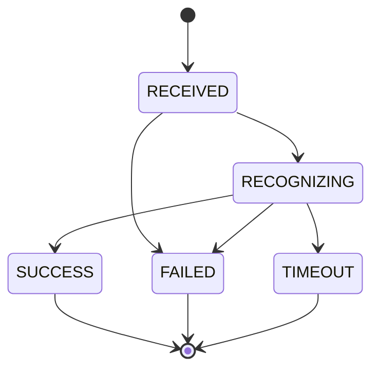

# 接口调用工程师｜第二周专业知识自学清单

**学习目标：** 掌握文件完整性检查、异步回调、请求关联和超时状态，配合[本周任务](../../task/02_第二次任务/接口调用工程师.md)完成录音交接。

下面是独立编写的通用 Python 教学示例，不引用项目源码。每个代码块都可以单独保存为 `.py` 文件，用 Python 3 运行；本地函数和文件练习不代表已经完成 ROS 通信或真实识别。

## 一、数据流框架


**图示说明：** 接口岗位负责交接。接收文件、识别成功和窗口显示是不同环节，需要分别确认。

## 二、知识点讲解

### 1. 文件路径：用 Path 表示文件地址

路径就是文件的地址。相对路径从当前工作目录开始找，绝对路径写出完整位置。`Path` 是 Python 中处理路径的工具。

```python
from pathlib import Path

path = Path("audio") / "sample.wav"  # / 用于连接目录和文件名
print("文件名：", path.name)
print("扩展名：", path.suffix)
print("完整路径：", path.resolve())
print("文件是否存在：", path.is_file())
```

**观察：** 前两项是 `sample.wav` 和 `.wav`；完整路径随运行目录变化。没有准备文件时，最后一项为 `False`。得到完整路径不会自动创建或传输文件。

### 2. 分块读取与摘要：检查收到的内容是否一致

文件较大时，可以每次读取一小块，而不是一次装入全部内存。SHA-256 摘要可用于比较交接前后的内容；摘要相同可作为完整性核对依据，但不证明文件来源可信。

```python
from hashlib import sha256
from pathlib import Path
from tempfile import TemporaryDirectory


def digest(path):
    hasher = sha256()
    with path.open("rb") as stream:
        while True:
            chunk = stream.read(4096)  # 每次最多读取 4096 字节
            if not chunk:
                break
            hasher.update(chunk)  # 逐块累计，与一次读完整文件的摘要一致
    return hasher.hexdigest()


with TemporaryDirectory() as folder:
    source = Path(folder) / "source.bin"
    received = Path(folder) / "received.bin"
    source.write_bytes(b"DEMO" * 3000)  # 演示字节，不是真实音频
    received.write_bytes(source.read_bytes())
    print("复制后：", digest(source) == digest(received))
    received.write_bytes(b"damaged")  # 模拟内容损坏
    print("被改动后：", digest(source) == digest(received))
```

**观察：** 先为 `True`，再为 `False`。分块大小与摘要算法是两个概念；实际传输仍需处理文件大小限制和失败回执。

### 3. 数据契约：用 dataclass 明确字段

数据契约约定“谁提供哪些字段、每个字段是什么含义”。`dataclass` 自动生成初始化方法；类型注解帮助阅读，但不会自动检查传入值，所以仍需显式校验。

```python
from dataclasses import dataclass, asdict


@dataclass(frozen=True)
class AudioRequest:
    request_id: str
    audio_path: str

    def __post_init__(self):
        # frozen=True 阻止普通字段重新赋值，不会代替数据校验。
        for value in (self.request_id, self.audio_path):
            if not isinstance(value, str) or not value.strip():
                raise ValueError("编号与路径必须是非空字符串")


request = AudioRequest("demo-001", "/example/a.wav")
print(request.request_id)
print(asdict(request))  # 转为字典，便于查看或序列化
try:
    AudioRequest("", "/example/a.wav")
except ValueError as error:
    print("拒绝输入：", error)
```

**注释：** `__post_init__()` 在初始化后运行。这个教学类型用于本机练习，实际 ROS 接口仍按任务书使用正式消息定义。

### 4. Future 与回调：请求发出后不原地等待

Future 表示“将来会得到的结果”。完成回调在结果就绪后执行；对尚未完成的 Future 调用 `result()` 可能阻塞，不能在界面刷新或通信回调里直接等待。

```python
from concurrent.futures import Future


def on_done(future):
    try:
        reply = future.result()  # 完成回调执行时，这个 Future 已完成
    except RuntimeError as error:
        print("调用失败：", error)
        return
    print("请求被接受：", reply["accepted"])


future = Future()
future.add_done_callback(on_done)
print("尚未完成：", not future.done())
print("此时可以继续处理其他事情")
# 手工完成 Future，模拟服务响应；本例没有网络、线程或 ROS 节点。
future.set_result({"request_id": "demo-001", "accepted": True})
```

**观察：** 先输出继续处理，再输出回调结果。标准库 Future 帮助理解异步流程；ROS Future 的具体 API 需要按所用库查看。服务接受请求与后续 Topic 发布识别文字也要分别确认。

### 5. 关联与去重：处理乱序到达的结果

不同输入的结果可能不按发送顺序返回。用编号查找待处理记录，再把结果移入完成记录，可以同时处理乱序、重复回调与未知编号。

```python
pending = {"demo-001": "a.wav", "demo-002": "b.wav"}
completed = {}


def accept_result(message):
    request_id = message["request_id"]
    if request_id in completed:
        return "重复结果，跳过"
    if request_id not in pending:
        return "未知编号，跳过"
    completed[request_id] = dict(message)  # 保存独立的一份结果
    del pending[request_id]  # 本次输入已经结束
    return "已保存"


messages = [
    {"request_id": "demo-002", "text": "DEMO 第二份"},
    {"request_id": "demo-001", "text": "DEMO 第一份"},
    {"request_id": "demo-002", "text": "DEMO 重复消息"},
]
for message in messages:
    print(accept_result(message))
print("第一份：", completed["demo-001"]["text"])
print("剩余等待数：", len(pending))
```

**观察：** 第二份先到也能归档到自己的编号，重复消息不会覆盖记录。这是单进程、顺序执行的演示；跨线程或程序重启后的去重还需要额外设计。

### 6. 异常处理：用 try 和 except 说明失败

读文件可能失败。`try` 放尝试执行的代码，`except` 处理指定错误，让程序给出原因，而不是填一段假结果。

```python
from pathlib import Path
from tempfile import TemporaryDirectory

with TemporaryDirectory() as folder:
    path = Path(folder) / "missing.wav"  # 特意不创建这个文件
    try:
        data = path.read_bytes()
        print("文件已读取：", len(data))
    except FileNotFoundError:
        print("文件不存在，请检查路径")
    except OSError as error:
        print("文件读取失败：", error)
```

**观察：** 输出“文件不存在，请检查路径”。错误发生在文件环节，不能报告为识别成功。

### 7. 解析与校验分层：合法 JSON 不一定是合法请求

接收文本时，先解析 JSON，再检查顶层结构、字段类型与取值。把失败分成“解析失败”和“字段不符合约定”，排查时会更清楚。

```python
import json


def parse_request(raw):
    data = json.loads(raw)  # 文本格式错误时抛出 JSONDecodeError
    if not isinstance(data, dict):
        raise ValueError("顶层必须是对象")
    for field in ("request_id", "audio_path"):
        value = data.get(field)
        if not isinstance(value, str) or not value.strip():
            raise ValueError(f"{field} 必须是非空字符串")
    return data


for raw in ['{"request_id":"r1","audio_path":"/demo/a.wav"}',
            '{"request_id":"r2","audio_path":123}', '[]', '{bad']:
    try:
        print("有效请求：", parse_request(raw)["request_id"])
    except json.JSONDecodeError:
        print("解析失败：JSON 语法错误")
    except ValueError as error:
        print("字段校验失败：", error)
```

**观察：** 四份输入分别通过、字段失败、结构失败、解析失败。路径是否存在和音频是否有效仍由后续检查；JSON 练习不改变正式 ROS 通信类型。

### 8. 超时与迟到结果：结束等待不等于取消后端

请求可以记录截止时刻。超过时限后，调用方结束等待；后端可能仍在运行，所以迟到结果还必须核对本次记录是否已经结束。这里用可传入的时钟数值练习，避免真的等待几秒。

```python
pending = {"demo-001": {"deadline": 12.0}}
finished = {}


def expire(now):
    # 遍历副本，避免一边遍历字典一边删除键。
    for request_id, record in list(pending.items()):
        if now >= record["deadline"]:
            finished[request_id] = "TIMEOUT"
            del pending[request_id]


def on_result(request_id, now):
    expire(now)  # 即使定时检查尚未执行，也先检查截止时间
    if request_id not in pending:
        return "忽略未知或已结束请求的结果"
    del pending[request_id]
    finished[request_id] = "SUCCESS"
    return "结果已接受"


expire(11.0)
print("仍在等待：", "demo-001" in pending)
print(on_result("demo-001", 12.1))
print("最终状态：", finished["demo-001"])
```

**注释：** 实际截止时刻可用 `monotonic() + timeout` 计算，并使用同一时钟比较。超时不保证远端取消；对有副作用的业务，也不能未经约定就自动重试。

### 9. 日志：把发生了什么记录清楚

日志帮助同伴排查问题。`INFO` 记录一般进展，`WARNING` 提醒需要关注，`ERROR` 记录错误；带上请求编号，才能找到同一次输入的记录。

```python
import logging

logging.basicConfig(level=logging.INFO, format="%(levelname)s %(message)s")
logger = logging.getLogger("handoff_demo")
request_id = "demo-001"

logger.info("request_id=%s 文件已收到", request_id)
logger.warning("request_id=%s 正在等待识别结果", request_id)
logger.error("request_id=%s DEMO：模型不可用", request_id)
```

**观察：** 三行记录包含不同级别和同一个编号。这个例子只向终端输出演示日志；正式记录中不要写入账号密码或整段音频内容。

### 10. 状态机：限制状态按允许的顺序变化

状态机把“目前在哪一步、下一步允许去哪”写清楚。例如收到文件后才能识别，识别后才进入成功或失败；已经结束的请求不能被旧进度消息改回处理中。



```python
allowed = {
    "RECEIVED": {"RECOGNIZING", "FAILED"},
    "RECOGNIZING": {"SUCCESS", "FAILED", "TIMEOUT"},
    "SUCCESS": set(), "FAILED": set(), "TIMEOUT": set(),
}


def transition(current, target):
    if target not in allowed[current]:
        raise ValueError(f"不允许从 {current} 跳到 {target}")
    return target


state = "RECEIVED"
state = transition(state, "RECOGNIZING")
state = transition(state, "SUCCESS")
print("当前状态：", state)
try:
    state = transition(state, "RECOGNIZING")  # 模拟迟到进度消息
except ValueError as error:
    print("拒绝回退：", error)
```

**观察：** 成功后不能回到识别中。这是教学状态定义；实际系统的状态名、允许跳转和失败字段需要先与同伴统一。

## 三、组合示例：交接文件并核对内容

下面组合路径检查、分块摘要、接收回执和错误分类。两个函数在同一进程中直接调用，只练习接口边界；收到文件不代表识别成功。

```python
from hashlib import sha256
from pathlib import Path
from tempfile import TemporaryDirectory


def digest(path):
    hasher = sha256()
    with path.open("rb") as stream:
        for chunk in iter(lambda: stream.read(4096), b""):
            hasher.update(chunk)  # iter 的第二个参数表示遇到空字节时结束
    return hasher.hexdigest()


def receive(request):
    path = Path(request["audio_path"])
    valid = path.stat().st_size == request["size"] and digest(path) == request["sha256"]
    return {"request_id": request["request_id"], "accepted": valid,
            "code": "RECEIVED" if valid else "CHECKSUM_MISMATCH"}


def handoff(request_id, path, receiver):
    # 接收方沿用编号，不能在交接的每一层另造一个编号。
    try:
        if not path.is_file():
            raise FileNotFoundError("输入文件不存在")
        size = path.stat().st_size
        if not 0 < size <= 1024 * 1024:
            raise ValueError("演示限制：文件应在 1 字节到 1 MiB 之间")
        request = {"request_id": request_id, "audio_path": str(path.resolve()),
                   "size": size, "sha256": digest(path)}
        reply = receiver(request)
        if reply["request_id"] != request_id:
            raise ValueError("回执编号不匹配")
        return reply
    except OSError as error:
        return {"request_id": request_id, "accepted": False, "code": "FILE_ERROR",
                "message": str(error)}
    except ValueError as error:
        return {"request_id": request_id, "accepted": False, "code": "INVALID_REQUEST",
                "message": str(error)}


def corrupt_then_receive(request):
    Path(request["audio_path"]).write_bytes(b"changed")
    return receive(request)  # 模拟计算摘要后、接收核对前，内容发生变化


with TemporaryDirectory() as folder:
    path = Path(folder) / "demo.bin"
    path.write_bytes(b"DEMO")  # 只练习传输内容核对，不作为真实音频
    print(handoff("a", path, receive)["code"])
    print(handoff("b", path, corrupt_then_receive)["code"])
    print(handoff("c", Path(folder) / "missing.bin", receive)["code"])
```

**观察与练习：** 依次输出 `RECEIVED`、`CHECKSUM_MISMATCH`、`FILE_ERROR`。再让接收方返回错误编号，观察交接方如何拒绝。示例假设交接期间文件由调用方控制；真实传输需保存独立接收文件，避免边读取边改写，并按任务书核对录音格式。

## 四、思考与练习

1. 文件名相同，为什么仍可能需要核对字节数和摘要？
2. 两份结果倒序返回、同一份返回两次时，怎样分别归档？
3. 请求已经超时后，迟到的成功结果能否直接覆盖状态？为什么？

将自己的解释、示例输出和任务操作步骤合并为一份说明。摘要、超时与去重先在独立示例中验证；持久化队列和跨进程恢复放到后续学习。

## 五、参考资料

- [Python：Path 与文件操作](https://docs.python.org/3.10/library/pathlib.html)。
- [Python：函数与控制流程](https://docs.python.org/3.10/tutorial/controlflow.html)。
- [Python：JSON 转换](https://docs.python.org/3.10/library/json.html)。
- [Python：日志](https://docs.python.org/3.10/library/logging.html)。
- [Python：数据类](https://docs.python.org/3.10/library/dataclasses.html)。
- [Python：摘要计算](https://docs.python.org/3.10/library/hashlib.html)。
- [Python：Future](https://docs.python.org/3.10/library/concurrent.futures.html)。
- [Python：单调时钟](https://docs.python.org/3.10/library/time.html#time.monotonic)。
