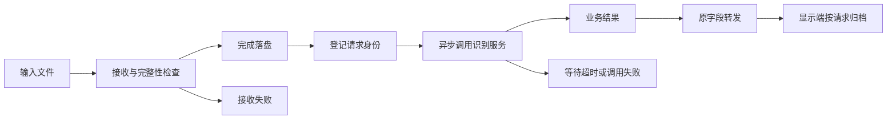
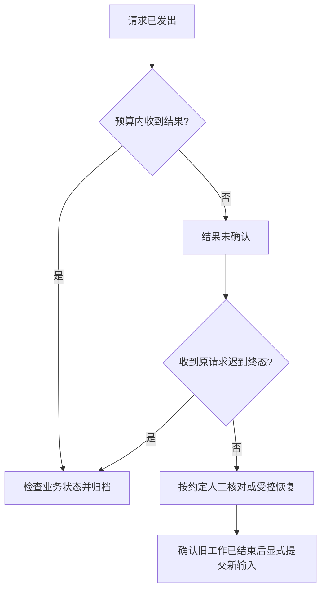

# 接口调用工程师｜第二周专业知识自学清单

**学习主题：** 完整文件交付、异步接口与请求生命周期。

**建议周期：** 5 个工作日，与[第二周接口任务](../../task/02_第二次任务/接口调用工程师.md)同步。

**前置基础：** 理解文件传输、绝对路径、数据类型和模块通信。

本文用通用框架图和教学伪代码解释原理，不展示项目源码。伪代码用于说明步骤，省略具体框架和错误映射，不能直接复制运行；实际端点与操作按任务书执行。

## 一、学习目标与总体框架

第一周理解“数据从哪里来、交给谁”，第二周进一步理解“何时交付完整、哪一次请求、是否真正完成、失败后如何恢复”。不另做一套练习系统，使用实际任务的观察来解释这些知识。



**图示注释：** 接收失败属于文件环节；等待超时属于调用环节；识别结果属于业务环节。三个环节的成功与失败不能混为一谈。发送端显示“发送完”也不能单独证明接收或识别完成。

## 二、知识点讲解与注释

### 1. PCM、WAV 与真实格式（重点）

PCM 是采样数据，WAV 是描述采样参数并装载数据的文件格式。16 kHz、单声道、16 位 PCM 的音频数据量约为每秒 `16000 × 1 × 2 = 32000` 字节；WAV 还包含文件头等内容。

**理解注释：** 传“完整 WAV 文件”和传“裸 PCM 片段”是不同契约。扩展名相同不保证内容合法，修改采样率标签也不是重采样。接收方应读取实际参数并检查非空、长度和允许格式。

**任务观察：** 比较一段短录音的时长、WAV 参数与实际字节数，解释差异；用格式错误样本观察是否明确拒绝。

### 2. 分块、完整性与原子交付（重点）

分块是把文件拆成小份传输；接收端按编号收齐后再重组。仅知道块数还不够保证来源正确：不同传输的块可能混在一起，内容也可能不一致。

**理解注释：** 传输 ID 区分不同文件，校验和验证内容，ACK 表示应用接收确认；底层传输可靠性不能代替这些业务保证。没有这些能力时，必须明确单发送端、单文件等限制。

**原子交付**指下游只看见准备完成的文件。例如先写临时文件，关闭并完成检查后，再在同一文件系统内改名交付。它能减少半文件读取问题，但不自动证明断电后持久化，也不替代内容校验。

```text
教学伪代码：收到一块文件数据
    检查块编号、总数、长度是否在允许范围
    如果已有传输身份：检查是否属于同一传输
    如果同一编号已存在且内容冲突：拒绝并清理本次接收
    保存本块，并更新最后接收时间

    如果尚未收齐：继续等待，不调用下游
    如果已经收齐：
        按编号重组并验证内容
        写入唯一的临时文件并关闭
        在同一文件系统内改名为最终文件  // 下游不会读到写到一半的文件
        只交付这个确定文件，不扫描“最新文件”
```

**伪代码注释：** 传输身份和内容校验属于理想契约；实际工具若没有，应写明限制，不能通过增加几行注释就宣称具备可靠传输。

### 3. 路径、权限与文件不变性（重点）

绝对路径消除当前工作目录差异，但只对对应机器的文件系统有意义。另一台机器出现同名路径，不代表是同一文件；还需检查可读权限与约定目录范围。

**理解注释：** 文件提交后应保持内容不变。客户端等待超时后，服务端仍可能读取旧文件；覆盖旧路径会让同一请求读取不同内容。每次输入使用独立文件，可减少此类混淆。

**任务观察：** 从下游运行环境读取交付路径，说明不存在、无权限、格式错误分别在哪一层失败。

### 4. 异步调用、Future 与单请求约束（重点）

异步调用先返回一个代表未来结果的对象，程序可以继续处理其他事件。之后通过回调或短轮询读取结果；不能为了“等它完成”在主循环里忙等。

**理解注释：** 单请求约束表示当前最多处理一个输入，忙碌时明确拒绝新输入；它不等于已有任务队列。如果要增加队列，还需确定容量、拒绝策略和退出规则。

```text
教学伪代码：提交识别
    如果当前有待确认请求：返回“忙碌或结果未确认”
    校验输入，创建本次唯一身份
    登记请求与文件的对应关系
    进入“等待服务”

周期检查：
    如果服务可用且尚未发送：异步发送一次，保存 Future
    如果 Future 已完成：读取业务结果，按本次身份归档
    如果等待预算耗尽：标记“结果未确认”，不自动重新发送
```

**伪代码注释：** “已登记”“已发送”和“业务成功”是三件事。Future 完成后仍要检查业务状态，不能仅凭没有抛异常就认定识别成功。

### 5. 请求身份、转发与防重边界（重点）

请求 ID 说明“这是哪一次处理”，会话与输入片段 ID 描述更大的上下文。转发应保留这些字段，使文件、阶段和文字可以追踪到同一来源。

**理解注释：** 消息重复、文件重复提交和请求重复执行是不同问题。显示端可以去重重复事件，但无法因此阻止服务端再次推理；每次都生成新 ID，也不能识别出用户其实重交了同一文件。

**任务观察：** 追踪两段输入的身份；说明当前工具在哪一层防重、记录是否跨重启保存，不能把有限登记写成永久幂等。

### 6. QoS、发现与分层排查

通信需要端点名、类型、发现范围和 QoS 相互匹配。Reliable 解决一部分通信可靠性问题，Volatile 影响晚加入者能否获得旧数据；二者均不保证业务完成。

**理解注释：** 按“进程 → 发现 → 类型与 QoS → 文件 → 服务 → 业务结果 → 显示”排查，比直接把所有问题归为网络断线更有效。日志应带请求身份、操作和错误环节，避免只写“失败”。

**任务观察：** 检查转发前后的结构化消息是否一致；晚启动显示端时，区分“没有新事件”和“程序离线”。

### 7. 超时、取消与恢复（重点）

超时表示本方等待预算用尽；取消本地 Future 不等于服务端推理被取消。对端是否仍在运行，需要实际终态或受控恢复步骤确认。



**图示注释：** 图中没有“超时立即重发”。如果系统提供查询，可按原 ID 查询；没有查询时应说明限制，不假设存在恢复接口。

## 三、五天学习与任务产物

| 时间 | 学习重点 | 在配套任务中形成的产物 |
|---|---|---|
| 第 1 天 | 格式、路径与完整性 | 输入、目录和通信清单 |
| 第 2 天 | 异步调用与单请求 | 请求生命周期说明 |
| 第 3 天 | 身份与原字段转发 | 两段真实输入的追踪记录 |
| 第 4 天 | 超时、传输异常与恢复 | 故障观察、限制和处理步骤 |
| 第 5 天 | 联合解释与复现 | 知识笔记、操作说明和验收记录 |

## 四、自主研究与提交要求

1. 发送完成、接收完成、调用完成和业务完成各需要什么证据？
2. 为什么不能把“收到了全部块”当作永久可靠传输？
3. 接口超时后覆盖同名文件，会产生什么问题？
4. 如何区分忙碌拒绝、队列排队和结果未确认？
5. 为什么显示端去重不能替代服务端幂等？
6. 没有查询和 ACK 的工具应如何写清恢复边界？

笔记使用“自己的解释 → 一张图或一段伪代码 → 实际观察 → 尚存疑问 → 资料来源”。功能交付按[岗位任务书](../../task/02_第二次任务/接口调用工程师.md)，验收使用[共同记录模板](../../task/02_第二次任务/验收记录模板.md)。

## 五、参考资料

- [ROS 2 Humble：接口](https://docs.ros.org/en/humble/Concepts/Basic/About-Interfaces.html)、[QoS](https://docs.ros.org/en/humble/Concepts/Intermediate/About-Quality-of-Service-Settings.html)。
- [Python 3.10：wave](https://docs.python.org/3.10/library/wave.html)：理解 WAV 参数与文件关闭。
- [Python 3.10：Future](https://docs.python.org/3.10/library/concurrent.futures.html#future-objects)：理解异步结果；实际 ROS Future 的行为还需以对应 API 为准。
