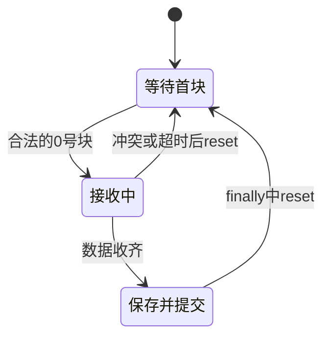

# 接口调用工程师｜第二周专业知识自学清单

**学习目标：** 看懂项目中“分块发送文件 → 接收重组 → 异步请求识别 → 转发结果”的链路，配合[本周任务](../../task/02_第二次任务/接口调用工程师.md)完成两份录音交接。

本页代码取自第一次任务后参考项目中的 `AudioFileSender`、`AudioFileReceiver`、`RecognitionClient` 和 `AudioInterfaceNode`，直接放在文档内。每段注明截取位置和教学简化；保留项目字段与关键逻辑，删去部分日志和初始化。带 `self` 的片段需要对应对象上下文，含 ROS 类型的片段需要已构建的 ROS 环境，不能逐段当作完整脚本运行。第三节用测试替身练习重组，不代表真实传输或识别。

## 一、项目数据流


**阅读重点：** 文件块、识别请求、识别结果是三种不同数据。文件协议目前没有传输 ID、校验和与 ACK；不能把后面的请求编号当作已有的文件传输编号。

## 二、知识点讲解

### 1. 参数与路径：运行时指定文件

**取自：** `AudioFileSender.__init__()` 的路径初始化，封装为教学方法。参数让运行者选择录音，不必每次修改源码。`expanduser()` 展开用户目录，`resolve()` 得到绝对路径，但不会把文件复制到 AI 主机。

```python
from pathlib import Path


def configure_input(self):
    self.declare_parameter("input_path", "")
    input_path = self.get_parameter("input_path").value
    if not input_path:
        raise ValueError("Set input_path to a WAV file")
    self.input_path = Path(input_path).expanduser().resolve()
    self.audio_data = self.input_path.read_bytes()  # 二进制读取整个文件
```

**理解：** 路径为空与文件不存在是两类问题；前者由参数检查发现，后者会在读取时抛出文件错误。现有实现一次读入全文件，不是流式录音。

### 2. 分块与帧头：一条消息怎样装下一部分文件

**取自：** `AudioFileSender` 的分块计算与 `send_chunk()` 的消息内容，合并为纯函数。每块最多 8 KiB，前两项分别是块编号和总块数。

```python
def make_chunks(audio_data):
    chunk_size = 8 * 1024
    total_chunks = (len(audio_data) + chunk_size - 1) // chunk_size
    if not 1 <= total_chunks <= 255:
        raise ValueError("数据块数量超过当前协议支持范围")
    messages = []
    for current_chunk in range(total_chunks):
        start = current_chunk * chunk_size
        chunk_data = audio_data[start:start + chunk_size]
        # ROS UInt8MultiArray.data 中的元素都是 0～255 的整数。
        messages.append([current_chunk, total_chunks] + list(chunk_data))
    return messages


messages = make_chunks(b"DEMO" * 3000)  # 仅练习字节协议，不是真实 WAV
print("块数：", len(messages))
print("第一块头部：", messages[0][:2])
print("第二块有效字节：", len(messages[1]) - 2)
```

**观察：** 共两块，首块头部为 `[0, 2]`，第二块正文为 3808 字节。总大小上限为 `255 × 8192 = 2088960` 字节；这不是适合无限长文件的通用协议。

### 3. 定时发送：等待连接但不阻塞回调

**取自：** `AudioFileSender.send_chunk()`，保留连接等待和发送逻辑，删去日志。原节点每 0.1 秒调用一次本方法。

```python
import time
from std_msgs.msg import UInt8MultiArray


def send_chunk(self):
    if self.publisher.get_subscription_count() == 0:
        self.connection_wait_start = None
        return
    if self.connection_wait_start is None:
        self.connection_wait_start = time.monotonic()
        return
    if time.monotonic() - self.connection_wait_start < 1.0:
        return  # 等下一轮回调，不在这里 sleep
    if self.current_chunk >= self.total_chunks:
        self.timer.cancel()
        return
    start = self.current_chunk * self.chunk_size
    chunk_data = self.audio_data[start:start + self.chunk_size]
    msg = UInt8MultiArray()
    msg.data = [self.current_chunk, self.total_chunks] + list(chunk_data)
    self.publisher.publish(msg)
    self.current_chunk += 1
```

**理解：** 发现订阅者不代表接收方已保存文件。项目使用可靠 QoS，但可靠传输设置也不能代替文件级的完成回执。

### 4. 接收校验：重复块与冲突块分别处理

**取自：** `AudioFileReceiver.receive_callback()` 的接收部分，封装为 `receive_chunk()` 并增加布尔返回值，表示是否收齐。对象需有 `audio_chunks`、`total_chunks`、`last_chunk_at` 和 `reset()`。

```python
import time


def receive_chunk(self, msg):
    if self.recognition.busy or len(msg.data) <= 2:
        return False
    chunk_id, total = msg.data[:2]
    if not 1 <= total <= 255 or chunk_id >= total or len(msg.data) > 8194:
        return False
    if self.total_chunks is None:
        if chunk_id != 0:
            return False  # 第一个块必须是 0 号块
        self.total_chunks = total
    if self.total_chunks != total:
        self.reset()
        return False
    payload = bytes(msg.data[2:])
    if chunk_id in self.audio_chunks and self.audio_chunks[chunk_id] != payload:
        self.reset()  # 同编号内容不同，不能继续拼接
        return False
    self.audio_chunks[chunk_id] = payload
    self.last_chunk_at = time.monotonic()
    return len(self.audio_chunks) == self.total_chunks
```

**理解：** 同编号、同内容不会增加计数；同编号、不同内容会重置。0 号块之后可以按编号重组乱序块，但协议无法可靠区分两个发送方或两次重叠传输，所以本周仍一次发一份。

### 5. 有序重组与保存：写完后再交给识别

**取自：** `AudioFileReceiver.receive_callback()` 的保存部分，单独封装并返回完成路径。每次生成独立文件名，避免下一份录音覆盖上一份还在使用的文件。

```python
import os
import uuid


def save_completed(self):
    total = self.total_chunks
    completed = self.output_path.with_name(
        f"{self.output_path.stem}-{uuid.uuid4().hex}.wav")
    temporary = completed.with_suffix(".wav.part")
    self.output_path.parent.mkdir(parents=True, exist_ok=True)
    # 按块编号拼接，而不是按字典插入顺序拼接。
    temporary.write_bytes(b"".join(self.audio_chunks[i] for i in range(total)))
    os.replace(temporary, completed)  # 临时文件写完并关闭后改名
    return completed
```

**理解：** 应先确认收齐，再调用本方法，再提交识别。临时文件与完成文件在同一目录；改名有助于避免下游读取正在写入的路径，但不代表已经校验了 WAV 内容。

### 6. 请求元数据：编号贯穿后续识别

**取自：** `RecognitionClient.submit()`，删去拒绝时的日志。这里使用项目真实的 `RecognizeAudio.Request` 字段。

```python
import time
import uuid
from pathlib import Path
from robot_interfaces.srv import RecognizeAudio


def submit(self, path):
    if self.busy:
        return False
    request = RecognizeAudio.Request()
    request.stamp = self.node.get_clock().now().to_msg()
    request.request_id = uuid.uuid4().hex
    request.session_id = request.request_id
    request.segment_id = request.request_id
    request.input_context_id = request.request_id
    request.audio_path = str(Path(path).expanduser().resolve())
    # 文件导入没有可信的录音起止时间，保留默认零值，不伪造时间。
    self.request = request
    self.started = time.monotonic()
    return True
```

**理解：** 这份请求的四个 ID 在文件导入场景里暂用同一个值，但含义不同。`submit()` 返回 `True` 只表示本地已登记，远端服务还没有保证识别成功。

### 7. 异步轮询：先发起，再检查 Future

**取自：** `RecognitionClient.poll()` 的发起和完成分支，超时分支单列到下一节。`self.future` 初始化为 `None`，定时器周期为 0.1 秒。

```python
def poll_response(self):
    if self.request is None:
        return
    if self.future is not None and self.future.done():
        try:
            result = self.future.result().result  # 服务响应中的 result 字段
            self.node.get_logger().info(
                f"{result.request_id}: status={result.status} text={result.text}")
        except Exception as error:
            self.node.get_logger().error(f"Recognition call failed: {error}")
        self.request = self.future = None
        return
    if self.future is None and self.client.service_is_ready():
        self.future = self.client.call_async(self.request)
```

**理解：** `.done()` 之前不等待 `.result()`。这个分支节选没有超时检查，不能单独替换完整 `poll()`；完整实现还要执行下一节逻辑。

### 8. 超时清理：取消本地等待，不自动重发

**取自：** `RecognitionClient.poll()` 的超时分支，封装为 `check_timeout()`。原方法在“已完成”分支之后检查超时。

```python
import time


def check_timeout(self):
    if self.request is None:
        return False
    timeout = self.node.get_parameter("recognition_timeout").value
    if time.monotonic() - self.started <= timeout:
        return False
    self.node.get_logger().error("Recognition timeout; server work may still complete")
    if self.future is not None:
        self.client.remove_pending_request(self.future)
        self.future.cancel()
    self.request = self.future = None
    return True
```

**理解：** 删除挂起请求与取消 Future 是本地清理，不保证模型已停止。参考实现会清除本地忙碌标记，但后端可能继续工作；遇到超时先排查，不让组员反复重发。

### 9. 类型化转发：保持原消息内容

**取自：** `AudioInterfaceNode.__init__()` 的发布订阅创建，封装为教学方法。接口层把 AI 侧消息转发到显示端，不重写文字或请求编号。

```python
from robot_interfaces.msg import AudioProcessingState, RecognizedText


def create_forwarding(self):
    self.status_pub = self.create_publisher(
        AudioProcessingState, "/interaction/asr_status", 10)
    self.text_pub = self.create_publisher(
        RecognizedText, "/interaction/asr_text", 10)
    self.status_sub = self.create_subscription(
        AudioProcessingState, "/ai/asr_status", self.status_pub.publish, 10)
    self.text_sub = self.create_subscription(
        RecognizedText, "/ai/asr_text", self.text_pub.publish, 10)
```

**理解：** 状态消息和文字消息分开传递。订阅句柄保存在对象上，回调直接调用发布者的 `publish()`；不能只转发 `text` 而丢掉身份和错误字段。

### 10. 接收状态复位：失败后不残留半份文件

**取自：** `AudioFileReceiver.reset()`、`check_timeout()`，删去日志。定时检查针对未收齐的数据，不是识别请求超时。

```python
import time


def reset(self):
    self.audio_chunks.clear()
    self.total_chunks = None


def check_timeout(self):
    timeout = self.get_parameter("transfer_timeout").value
    if (self.total_chunks is not None
            and time.monotonic() - self.last_chunk_at > timeout):
        self.reset()
```



**理解：** 接收方法在保存操作的 `finally` 中也会执行 `reset()`。即使写文件失败，也不能把旧数据留给下一份录音。

## 三、组合示例：用项目接收规则重组文件

由 `AudioFileReceiver.receive_callback()`、`reset()` 和保存逻辑裁剪而来。为便于本机练习，将 ROS 消息改为整数列表，将识别客户端改为只记录路径的测试替身；保留头部校验、重复冲突处理、编号拼接与独立文件保存。这里只重组字节，未执行 ROS 通信或真实识别。

```python
import os
import uuid
from pathlib import Path
from tempfile import TemporaryDirectory


class ReceiverLesson:
    def __init__(self, output_path, submit):
        self.output_path = output_path
        self.submit = submit  # 测试替身：只接收路径
        self.audio_chunks = {}
        self.total_chunks = None

    def reset(self):
        self.audio_chunks.clear()
        self.total_chunks = None

    def receive_callback(self, data):
        if len(data) <= 2:
            return "INVALID"
        chunk_id, total = data[:2]
        if not 1 <= total <= 255 or chunk_id >= total or len(data) > 8194:
            return "INVALID"
        if self.total_chunks is None:
            if chunk_id != 0:
                return "WAIT_ZERO"
            self.total_chunks = total
        payload = bytes(data[2:])
        if self.total_chunks != total or (
            chunk_id in self.audio_chunks and self.audio_chunks[chunk_id] != payload
        ):
            self.reset()
            return "CONFLICT"
        self.audio_chunks[chunk_id] = payload
        if len(self.audio_chunks) != total:
            return "WAITING"
        completed = self.output_path.with_name(f"received-{uuid.uuid4().hex}.wav")
        temporary = completed.with_suffix(".wav.part")
        try:
            completed.parent.mkdir(parents=True, exist_ok=True)
            temporary.write_bytes(b"".join(self.audio_chunks[i] for i in range(total)))
            os.replace(temporary, completed)
            self.submit(completed)
            return "SUBMITTED"
        finally:
            self.reset()


with TemporaryDirectory() as folder:
    submitted = []
    receiver = ReceiverLesson(Path(folder) / "received.wav", submitted.append)
    # 故意用很小的演示块观察顺序，正文不是合法 WAV。
    for data in [[0, 3, 65], [2, 3, 67], [0, 3, 65], [1, 3, 66]]:
        print(receiver.receive_callback(data))
    print("重组字节：", submitted[0].read_bytes())  # b'ABC'
```

**动手改一改：** 把第二次出现的 0 号块内容从 `65` 改成 `88`，观察冲突后是否复位。这个裁剪例子省略了忙碌拒绝、定时超时与 ROS 初始化；真实联调仍使用项目完整节点。

## 四、思考与练习

1. 为什么重组时按编号拼接，而不是按收到消息的顺序拼接？
2. 文件块中的编号与 `request_id` 分别在什么时候产生，有什么区别？
3. 客户端超时之后，为什么不能声称模型已取消并立即不断重试？

结合片段写出自己的解释，再按任务书完成真实录音交接。校验和、传输 ID、ACK 等是后续改进方向，不是当前协议已有功能。

## 五、参考资料

- [Python：Path 与文件操作](https://docs.python.org/3.10/library/pathlib.html)。
- [Python：单调时钟](https://docs.python.org/3.10/library/time.html#time.monotonic)。

项目代码已内嵌，并以类名、方法名说明出处；无需跳转源码阅读。
