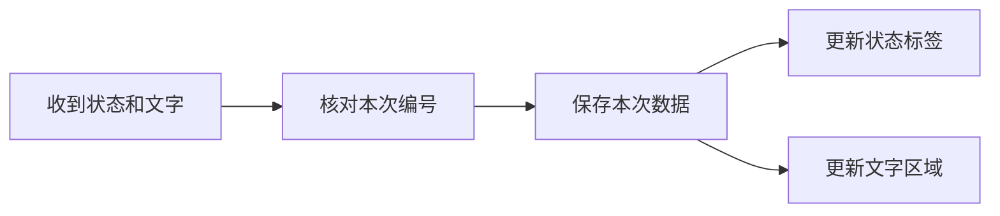

# 机器人可视化与监控工程师｜第二周专业知识自学清单

**学习目标：** 理解窗口、数据更新和本次结果显示，配合[本周任务](../../task/02_第二次任务/机器人可视化与监控工程师.md)接入真实状态与文字。

下面是独立编写的 Python 教学示例，不引用项目源码。每个短例子可单独保存运行；窗口例子需要已经准备好的 PySide6 环境。第三节提供组合示例。所有窗口均为 DEMO，不接 ROS，也不进行真实识别。

## 一、显示流程框架



**图示说明：** 可视化岗位负责显示数据。数据接收、编号判断和控件更新各有作用，不需要在窗口中重复运行模型。

## 二、知识点讲解

### 1. 窗口与控件：先显示一行文字

`QApplication` 管理界面程序，`QWidget` 是窗口，`QLabel` 用来显示短文字。`show()` 显示窗口，`app.exec()` 开始处理点击、绘制等界面事件。

```python
from PySide6.QtWidgets import QApplication, QLabel, QWidget

app = QApplication([])
window = QWidget()
window.setWindowTitle("DEMO：第一个窗口")
window.resize(320, 120)
label = QLabel("等待数据", window)  # 把标签放在 window 中
label.move(20, 30)
window.show()
app.exec()  # 关闭窗口后，这次运行结束
```

**观察：** 出现一个显示“等待数据”的窗口。先认识控件，再用布局管理器替代手工指定位置。

### 2. 布局与文字区：让控件按顺序排列

`QVBoxLayout` 把控件从上到下排列，窗口变化时帮助调整位置。`QPlainTextEdit` 适合显示多行文字，设为只读后用户不能直接改结果。

```python
from PySide6.QtWidgets import QApplication, QLabel, QPlainTextEdit, QVBoxLayout, QWidget

app = QApplication([])
window = QWidget()
window.setWindowTitle("DEMO：状态与文字")
layout = QVBoxLayout(window)
status_label = QLabel("DEMO 演示")
text_area = QPlainTextEdit()
text_area.setReadOnly(True)
text_area.setPlainText("第一行演示文字\n第二行演示文字")
layout.addWidget(status_label)
layout.addWidget(text_area)
window.show()
app.exec()
```

**观察：** 状态在上方，长文字在下方。`setPlainText()` 替换文字，`clear()` 清空文字。

### 3. 回调与信号：点击后执行一个函数

回调是事件发生时被调用的函数。按钮的 `clicked` 信号表示“被点击”，`connect()` 把信号与处理函数连接起来。

```python
from PySide6.QtWidgets import QApplication, QLabel, QPushButton, QVBoxLayout, QWidget

app = QApplication([])
window = QWidget()
window.setWindowTitle("DEMO：点击更新")
layout = QVBoxLayout(window)
status_label = QLabel("等待点击")
button = QPushButton("显示演示状态")
layout.addWidget(status_label)
layout.addWidget(button)


def on_click():
    status_label.setText("DEMO：收到了一次点击")


button.clicked.connect(on_click)  # 传函数名；不是在这里调用 on_click()
window.show()
app.exec()
```

**观察：** 点击后标签内容变化。接收外部消息时，也可以由回调函数保存数据并更新控件；跨线程更新属于后续内容。

### 4. 事件循环与定时器：检查后马上返回

界面要不断处理事件，不能在回调里一直等待模型。`QTimer` 可以隔一段时间调用一次函数；被调用的函数也必须很快返回。

```python
from PySide6.QtCore import QTimer
from PySide6.QtWidgets import QApplication, QLabel

app = QApplication([])
label = QLabel("DEMO：检查次数 0")
counter = {"value": 0}


def refresh():
    counter["value"] += 1
    label.setText(f"DEMO：检查次数 {counter['value']}")
    # 这里只更新显示；不要 sleep，也不要在这里等待模型。


timer = QTimer(label)  # 随标签一起释放
timer.timeout.connect(refresh)
timer.start(1000)  # 单位是毫秒，1000 毫秒等于 1 秒
label.show()
app.exec()
```

**观察：** 数字定期增加，窗口仍可移动和关闭。定时器不会自动把耗时操作变成后台任务，真正接消息时使用任务书的非阻塞方式。

### 5. 请求编号与当前结果：先清空，再显示本次内容

编号是本次输入的身份。新输入开始时先清空旧结果，收到结果后再检查编号，防止把上一份文字当作当前文字。

```python
current = {"request_id": "demo-002", "text": ""}  # 已切换到第二份
old_result = {"request_id": "demo-001", "text": "旧的演示文字"}
new_result = {"request_id": "demo-002", "text": "新的演示文字"}

for result in [old_result, new_result]:
    if result["request_id"] != current["request_id"]:
        print("跳过旧结果：", result["request_id"])
        continue  # 本轮结束，处理下一条
    current["text"] = result["text"]

print("当前文字：", current["text"])
```

**观察：** 第一条被跳过，最后保留“新的演示文字”。这里已经知道当前编号，实际怎样得到新输入编号由接口同学提供。

### 6. 状态映射与失败提示：按实际字段显示

字典可以把状态变成人能理解的文字。成功文字还需检查成功标记、成功状态和非空内容，未知状态也不能默认当作正常。

```python
status_names = {
    "WAITING": "等待数据",
    "RECOGNIZING": "正在识别",
    "SUCCESS": "识别完成",
    "FAILED": "识别失败",
}
print(status_names.get("OTHER", "状态未知"))

# 字符串状态是教学表示，接项目时按正式消息定义使用。
result = {"success": False, "status": "FAILED", "text": "",
          "message": "DEMO：文件不存在"}
if result["success"] and result["status"] == "SUCCESS" and result["text"].strip():
    print(result["text"])
else:
    print("没有成功文字：", result["message"])
```

**观察：** 未知状态得到“状态未知”，失败结果显示原因，不会显示上一份文字。

## 三、组合示例：带编号和延迟显示的演示窗口

把下面整个代码块保存为 `demo_window.py`，在已有 PySide6 环境中用 Python 运行。点击两份演示输入或失败按钮，观察编号、等待、结果与失败提示。这里用固定文字和定时器模拟消息到达，不连接项目，不代表真实 ASR。

```python
from PySide6.QtCore import QTimer
from PySide6.QtWidgets import (
    QApplication, QLabel, QPlainTextEdit, QPushButton, QVBoxLayout, QWidget,
)

app = QApplication([])
window = QWidget()
window.setWindowTitle("DEMO：识别结果显示练习")
window.resize(420, 280)
layout = QVBoxLayout(window)
status_label = QLabel("DEMO：等待输入")
id_label = QLabel("本次编号：无")
text_area = QPlainTextEdit()
text_area.setReadOnly(True)
button_a = QPushButton("演示第一份输入")
button_b = QPushButton("演示第二份输入")
button_error = QPushButton("演示失败")
for widget in [status_label, id_label, text_area, button_a, button_b, button_error]:
    layout.addWidget(widget)

state = {"request_id": "", "sequence": 0}


def start_demo(text, success):
    state["sequence"] += 1
    request_id = f"demo-{state['sequence']}"  # 每次点击都是新输入
    state["request_id"] = request_id
    id_label.setText(f"本次编号：{request_id}")
    text_area.clear()  # 先清除上一份结果
    status_label.setText("DEMO：正在等待演示结果")

    def finish():
        # 这个内部函数记住当前这次的编号和演示内容。
        if request_id != state["request_id"]:
            return  # 等待时切换了输入，旧结果不覆盖新输入
        if success and text.strip():
            status_label.setText("DEMO：演示结果已到达")
            text_area.setPlainText(text)
        else:
            status_label.setText("DEMO：失败，文件不存在")
            text_area.clear()

    QTimer.singleShot(500, finish)  # 延迟 500 毫秒调用，期间窗口仍可操作


def show_first():
    start_demo("第一份演示文字", True)


def show_second():
    start_demo("第二份演示文字", True)


def show_error():
    start_demo("", False)


button_a.clicked.connect(show_first)
button_b.clicked.connect(show_second)
button_error.clicked.connect(show_error)
window.show()
app.exec()
```

**动手改一改：** 修改标签文字、把延迟改为 1000 毫秒；先点第一份，再快速点第二份，确认旧结果没有覆盖新结果。接入真实数据另按任务书操作。

## 四、思考与练习

1. `connect(on_click)` 与直接写 `on_click()` 有什么区别？
2. 为什么用了定时器，回调里仍不能一直等待模型？
3. 切换输入时为什么先清空文字，收到结果后为什么还要核对编号？

将自己的解释、示例运行结果和任务步骤合并为一份说明。多线程、复杂历史和断线恢复放到后续学习。

## 五、参考资料

- [Qt for Python：第一个窗口](https://doc.qt.io/qtforpython-6/tutorials/basictutorial/widgets.html)。
- [Qt for Python：QTimer](https://doc.qt.io/qtforpython-6/PySide6/QtCore/QTimer.html)。
