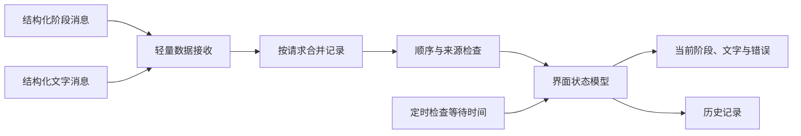
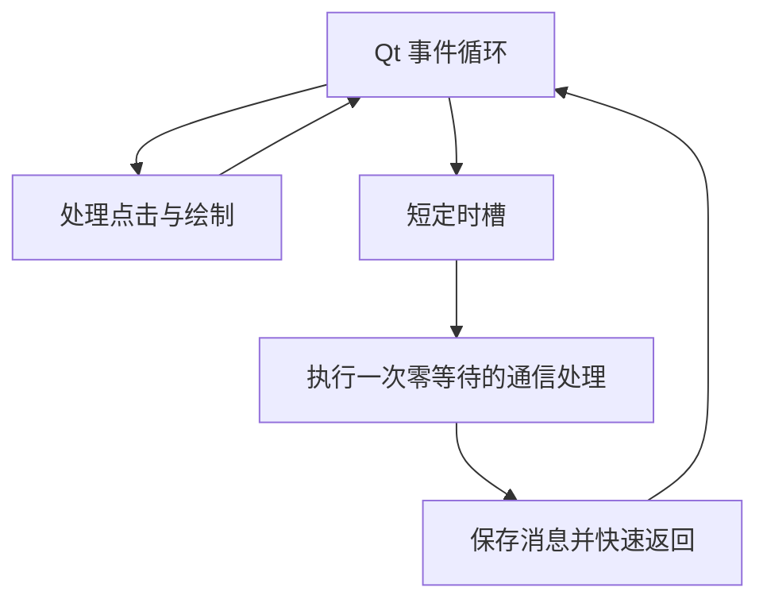

# 机器人可视化与监控工程师｜第二周专业知识自学清单

**学习主题：** 事件循环协作、结构化状态显示与本次结果管理。

**建议周期：** 5 个工作日，与[第二周可视化任务](../../task/02_第二次任务/机器人可视化与监控工程师.md)同步。

**前置基础：** 理解 GUI、控件、布局、定时器和基础动态显示。

本文使用通用框架图与教学伪代码，不展示项目源码。伪代码强调设计步骤，省略具体节点与界面类，不能直接运行；项目入口、实际接口和命令见任务书。

## 一、学习目标与总体框架

从“收到文字就显示”提升到“用户知道当前是哪一次输入、处在哪个阶段、失败在哪里、显示内容是否仍有效”。第二周先完成最小识别结果窗口，后续再接已经实现的录音控制、任务与监控能力。



**图示注释：** 接收、记录与绘制各有职责；显示端不重复执行识别，也不通过读取终端日志猜业务结果。先更新自己的数据模型，再由模型决定显示。

## 二、知识点讲解与注释

### 1. Qt 事件循环与非阻塞处理（重点）

事件循环负责处理点击、定时器、信号与绘制。把等待网络或模型计算放进界面回调，会让窗口无法及时响应；定时器回调也属于事件处理，并不会自动变成后台线程。

**理解注释：** 最小程序可以用定时器周期执行一次零等待的通信处理，但回调必须轻量；复杂程序可以分出通信线程，用信号把数据送回主线程更新控件。采用一种经过验证的方案即可。



**图示注释：** “零等待”只约束取消息时的等待，不保证回调没有耗时；如果回调执行大计算或等待服务，整个界面仍可能被阻塞。

### 2. 主线程、工作线程与信号（重点）

工作线程适合通信或耗时工作，界面控件应由主线程操作。线程间传递结构化数据，比直接跨线程修改控件更容易管理与验证。

**理解注释：** 继承线程类不会让它的所有方法自动在后台执行；对象归属、调用方式与信号连接共同决定执行位置。退出时还需停止线程，避免窗口关闭后后台仍在运行。

```text
教学伪代码：线程协作
    通信侧收到消息：
        转成只含本次数据的快照
        发出“记录更新”信号
        立即返回，不直接修改控件

    主线程收到信号：
        检查来源与请求身份
        更新记录模型
        从模型读取当前页需要显示的内容
        更新控件
```

**伪代码注释：** 跨线程传递后还应避免双方同时修改同一可变对象；数据快照或明确的所有权能减少并发问题。最小单线程方案无需为了形式强加线程。

### 3. 结构化字段与状态映射（重点）

结构化消息明确给出状态、身份、文字和错误，比解析自由日志可靠。界面把机器状态映射为可读文字，但不能改变业务含义。

| 收到的含义 | 显示思路 | 注释 |
|---|---|---|
| 未收到数据 | 尚未收到／未确认 | 不能默认正常 |
| 正在识别 | 正在识别本次输入 | 不编造百分比 |
| 阶段完成但文字未到 | 等待对应文字 | 不借用旧文字 |
| 成功且文字非空 | 展示真实文字 | 仍不表示机器人执行完成 |
| 无语音或失败 | 展示对应原因 | 不显示上次结果为本次成功 |
| 未知状态 | 显示未知及原值 | 防止新增枚举被误判正常 |

**任务观察：** 解释每个显示区域来自什么字段；没有可信置信度时隐藏分数，不人为补成百分之百。

### 4. 请求关联、当前与历史（重点）

阶段与文字可能从不同通道到达，顺序不固定。需要用同一请求身份合并；当前结果与历史结果是展示关系，不应靠“最后到达的文字”决定归属。

```text
教学伪代码：合并一条消息
    读取请求身份；缺少身份则标记无法关联
    找到或建立该请求的记录
    按消息种类更新该记录的阶段、文字或错误

    如果消息属于当前请求：
        仅根据当前记录刷新当前区
    否则：
        更新对应历史记录，不覆盖当前区

开始显示一个新请求：
    把旧请求移为历史
    当前文字设为“等待本次结果”
    不把历史成功状态带到新请求
```

**理解注释：** 若阶段先完成而文字还没到，保留“等待文字”；若 A 的迟到结果在 B 处理中到达，归档给 A。无法确定归属时显示未确认，不猜。

### 5. 去重、乱序与进程重启（重点）

重复消息不应重复追加，迟到阶段不应覆盖较新的阶段。同一来源、同一启动实例和同一请求内，可以用事件序号判断先后；重启后序号可能重新开始。

**理解注释：** 需要结合来源、启动标识和请求登记，已经退役的旧进程事件不能重新覆盖新状态。阶段枚举的数字只是编码，不是时间顺序；文字消息也不一定有同样的阶段序号。

```text
教学伪代码：检查阶段顺序
    读取来源、启动实例、请求身份和事件序号
    如果来源启动实例已退役：忽略旧事件
    如果仍是同一启动实例、同一请求：
        序号不大于已接收值 → 作为重复或迟到忽略
    否则按已约定的重启规则登记新来源
    保存本次事件，再刷新对应记录
```

**伪代码注释：** 如何确认新启动实例应有明确规则，不能仅凭“刚收到”就退休当前进程；实际方案需处理旧进程迟到与时间有效性。

### 6. 刷新频率、数据新鲜度与等待超时（重点）

刷新频率是界面重绘节奏，消息频率是数据更新节奏，二者不同。阶段消息通常只在阶段变化时发布，没有新阶段不自动代表断线。

**理解注释：** 心跳证明活性，部件状态说明就绪，业务事件说明阶段；没有这些来源时，界面只能显示已知数据和未确认。用单调时钟测本进程等待时间，跨机器数据时间仍需按协议理解。

```text
教学伪代码：周期检查
    当前时刻 = 本进程单调时钟
    如果当前请求仍未得到终态且超过等待预算：
        显示“等待超时，结果未确认”
        保留原请求身份，不自动重发
    如果只是阶段没有变化：
        不据此宣称节点已经退出
    保留旧数据时显示最后更新时间与历史标记
```

### 7. 晚加入、恢复与正常退出

显示端晚启动可能错过旧消息。如果已有查询能力，可按已知请求补查；没有查询就说明没有可用历史，不能虚构快照，也不能为了拿文字再触发一次识别。

**理解注释：** 客户端超时不一定停止服务端，迟到终态仍归原请求。关闭窗口只清理自己创建的定时器、节点和线程；外部启动的后端由其负责人停止。

**任务观察：** 分别验证等待期间拖动与关闭、晚加入无历史、重复消息、迟到旧文字、失败恢复；DEMO 标记与真实验收分别记录。

## 三、五天学习与任务产物

| 时间 | 学习重点 | 在配套任务中形成的产物 |
|---|---|---|
| 第 1 天 | 控件结构与事件循环 | 最小窗口与入口 |
| 第 2 天 | 通信接收、字段与状态映射 | 等待、阶段、文字和错误显示 |
| 第 3 天 | 关联、当前与历史 | 两段真实结果不串段 |
| 第 4 天 | 重复、迟到与超时 | 异常和恢复观察 |
| 第 5 天 | 退出、复现与讲解 | 知识笔记、操作说明和证据 |

## 四、自主研究与提交要求

1. 为什么定时器里执行耗时函数仍会卡界面？
2. 单线程轻量接收与工作线程方案分别适合什么情况？
3. 阶段先完成、文字后到时，应该如何显示？
4. 为什么不能把“最后收到”当作本次结果归属？
5. 为什么阶段数字不能用来比较时间先后？
6. 没有心跳和查询时，如何说明等待、断线与历史的边界？
7. 等待超时后迟到的文字应怎样归档，窗口关闭要清理哪些资源？

笔记使用“自己的解释 → 框架图或伪代码 → 实际观察 → 尚存疑问 → 资料来源”。具体研发要求见[岗位任务书](../../task/02_第二次任务/机器人可视化与监控工程师.md)，实测结果填[共同记录模板](../../task/02_第二次任务/验收记录模板.md)。

## 五、参考资料

- [Qt for Python：QThread](https://doc.qt.io/qtforpython-6/PySide6/QtCore/QThread.html)：理解对象归属、后台执行与信号。
- [Qt for Python：QTimer](https://doc.qt.io/qtforpython-6/PySide6/QtCore/QTimer.html)：理解定时槽与事件循环。
- [Python 3.10：单调时钟](https://docs.python.org/3.10/library/time.html#time.monotonic)：理解等待与超时计算。
- [ROS 2 Humble：QoS](https://docs.ros.org/en/humble/Concepts/Intermediate/About-Quality-of-Service-Settings.html)：理解匹配与晚加入行为。
