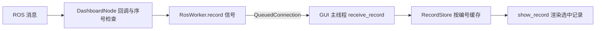
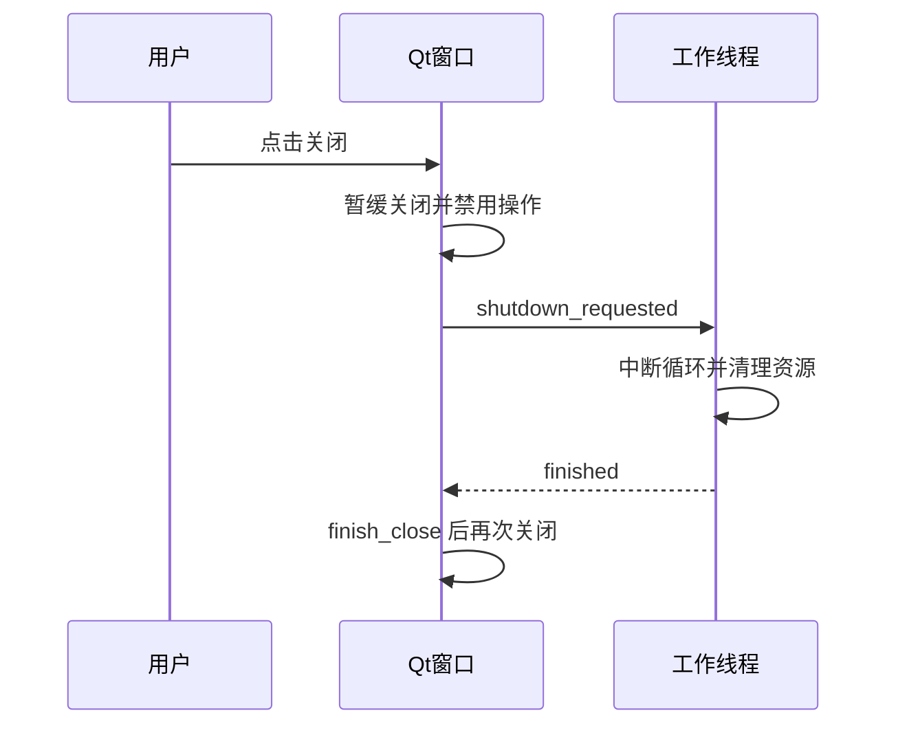

# 机器人可视化与监控工程师｜第二周专业知识自学清单

**学习目标：** 看懂项目怎样把 ROS 数据送到 Qt 主线程、按请求缓存，并展示 LLM 候选、缺参与错误，配合[本周任务](../../task/02_第二次任务/机器人可视化与监控工程师.md)显示原文、任务候选、追问与错误。

本页代码从当前 `ai-interaction-ui` 项目的 `RosWorker`、`DashboardNode`、`RecordStore`、`DashboardWindow` 和装配入口中截取并简化，直接写在文档内。第一次任务后的参考项目还没有完整窗口，因此这里用于学习后续界面实现，不能据此认为参考项目已经具备这些功能。片段注明省略内容，带 `self` 的方法需原对象上下文；第三节提供可单独运行的裁剪窗口，需要 PySide6。

## 一、项目显示框架



**阅读重点：** ROS 回调、数据缓存、控件渲染是三个层次。当前完整项目的统一状态入口包含 `/ai/audio_state`；本周经接口桥接收 `/interaction/asr_status`、`/interaction/parse_status` 与对应文字/结果，具体以共同端点表为准。ASR 与解析状态来自不同源，必须分别过滤和缓存，再统一渲染，不能将两个源的序号直接比较。

## 二、知识点讲解

### 1. 装配与连接方式：让界面槽在主线程执行

**取自：** `build_dashboard()` 中的连接部分，封装为 `connect_audio()`，省略其他业务信号。参数分别是已经创建的工作线程对象与窗口对象。

```python
from PySide6.QtCore import Qt


def connect_audio(worker, window):
    queued = Qt.ConnectionType.QueuedConnection
    worker.record.connect(window.receive_record, queued)
    worker.availability.connect(window.receive_availability, queued)
    worker.control.connect(window.control_result, queued)
    worker.finished.connect(window.on_worker_finished, queued)
    window.start_requested.connect(lambda: worker.command("start"))
    window.stop_requested.connect(lambda: worker.command("stop"))
```

**理解：** 数据通过排队连接交给属于 GUI 主线程的窗口槽处理；工作线程不直接改标签。`worker.command()` 在这里用于把操作放入线程安全队列，不应在这个被直接调用的方法中等待服务。

### 2. 信号契约：事件种类与数据分开传

**取自：** `RosWorker` 的信号定义和命令队列初始化，仅保留音频显示相关部分。完整类还有 ROS 节点、进程管理和 `run()`，本片段不能替代完整工作线程。

```python
import queue
from PySide6.QtCore import QThread, Signal


class RosWorker(QThread):
    record = Signal(str, dict)  # 例如 "state" 或 "asr"，以及对应字段
    availability = Signal(dict)
    control = Signal(dict)
    log = Signal(str)

    def __init__(self):
        super().__init__()
        self.commands = queue.Queue(maxsize=16)
```

**理解：** `Signal(str, dict)` 约束两项参数的形式，不会自动校验字典内部的 `request_id`、`event_seq` 等字段。发送方与接收方仍需遵守同一数据契约。

### 3. 命令队列：界面操作先入队，再由后台取出

**取自：** `RosWorker.command()` 与 `run()` 的队列部分，分别抽出方法。删去文本指令、草稿和其他操作分支，仅演示录音开始与停止。

```python
import queue


def command(self, operation, value=""):
    try:
        self.commands.put_nowait((operation, value))
    except queue.Full:
        self.report_log(f"未能排入操作：{operation}，操作队列已满")
        self.control.emit({"success": False, "message": "操作队列已满，请稍后再试"})


def drain_commands(self):
    while not self.commands.empty():
        operation, value = self.commands.get_nowait()
        self.node.request_control(operation)
```

**理解：** 队列的生产者是界面操作，消费者是工作线程。原 `run()` 在这个循环外执行 ROS 事件轮询与退出检查；这里的消费者还假定只有一个线程取队列，不能直接用于多个消费者。

### 4. 消息序号：同一来源与启动内拒绝旧事件

**取自：** `DashboardNode.on_state()` 的过滤与信号发送，删去日志和快照查询。`payload()` 将 ROS 消息转为字典并补充 `stamp_ns`，完整项目使用 ROS 的消息转换工具。

```python
def on_state(self, message):
    key = (message.source_node, message.boot_id, message.request_id)
    previous = self.sequences.get(key, 0)
    if message.event_seq <= previous:
        return
    self.sequences[key] = message.event_seq
    if len(self.sequences) > 1024:
        self.sequences.pop(next(iter(self.sequences)))
    self.events.record.emit("state", payload(message))
```

**理解：** `event_seq` 在相同来源、启动和请求内递增。不同启动编号的序号不能直接比较；这层过滤之后，记录缓存还会处理旧进程消息。

### 5. 记录缓存：按请求保存，并过滤旧启动

**取自：** `RecordStore` 的初始化与 `apply()` 核心逻辑，保留启动切换、事件序号、结果时间戳和容量限制。状态字典需要事先包含代码中访问的字段。

```python
from collections import OrderedDict


class RecordStore:
    def __init__(self, limit=100):
        self.limit = limit
        self.records = OrderedDict()
        self.boots = {}
        self.retired_boots = set()

    def apply(self, kind, value):
        request_id = value.get("request_id", "")
        if not request_id:
            return False
        record = self.records.get(request_id, {})
        previous = record.get(kind)
        if kind == "state":
            source, boot = value["source_node"], value["boot_id"]
            if (source, boot) in self.retired_boots:
                return False
            current = self.boots.get(source)
            if current and current[0] != boot:
                if value["stamp_ns"] < current[1]:
                    return False
                self.retired_boots.add((source, current[0]))
            self.boots[source] = (boot, max(value["stamp_ns"], current[1] if current else 0))
            if previous and previous["boot_id"] != boot:
                record = {}  # 新启动下不继续沿用旧记录内容
            if previous and previous["boot_id"] == boot and value["event_seq"] <= previous["event_seq"]:
                return False
        elif previous and value.get("stamp_ns", 0) < previous.get("stamp_ns", 0):
            return False
        record[kind] = value
        self.records[request_id] = record
        while len(self.records) > self.limit:
            self.records.popitem(last=False)
        return True
```

**理解：** 同一编号下分别保存 `state`、`asr` 等信息。缓存负责接受或拒绝数据，窗口负责显示；不需要在每个控件回调中重复编写排序规则。这里保留的是项目单一统一状态源下的现有规则。本周两个状态源应先分别过滤，缓存为 asr_state、parse_state，再按解析终态优先等规则渲染；不要直接把两种来源都塞入单个 state 槽位。它也不能解决所有时钟偏差与分布式乱序问题。

### 6. 按选择渲染：原文、候选、追问一起切换

**取自：** `DashboardWindow.show_record()`、`_show_candidate()`、`_show_result_details()` 的数据读取思路。为本周单任务教学，删除动作展开和草稿，把候选改为 JSON 字段展示；这是课程裁剪，需要 `candidate_text`、`message_label` 两个展示控件。

```python
import json


def show_record(self):
    record = self.store.records.get(self.selected_request, {})
    asr = record.get("asr", {})
    parsed = record.get("parse", {})
    self.request_label.setText(f"请求：{self.selected_request or '—'}")
    self.asr_text.setPlainText(asr.get("text", ""))
    candidate = parsed.get("candidate")
    self.candidate_text.setPlainText(
        json.dumps(candidate, ensure_ascii=False, indent=2) if candidate else "")
    messages = [parsed.get("message", ""), parsed.get("clarification_question", "")]
    if parsed.get("missing_fields"):
        messages.append("待补充：" + "、".join(parsed["missing_fields"]))
    if parsed.get("error_code"):
        messages.append("错误码：" + parsed["error_code"])
    self.message_label.setText("\n".join(filter(None, messages)))
```

**理解：** 用同一份记录驱动所有控件，候选缺失时也要清空旧内容。原文来自自己发送的文字或 ASR，不能从候选反推。这里不判断候选有效性，使用接口层已经核验的结果；`success=false` 的缺参结果也可能有值得展示的已知字段。

### 7. 按钮门控：状态未知时不假定可以开始

**取自：** `DashboardWindow.refresh_controls()`，只保留开始和停止录音按钮。`availability` 来自后台发现的服务与实际设备状态。

```python
def refresh_controls(self):
    value = self.availability
    available = not self.control_pending and not self.closing
    recording = value.get("recording")
    can_start = (available and value.get("start") and value.get("asr_ready")
                 and recording is False)
    can_stop = available and value.get("stop") and recording is not False
    self.start_button.setEnabled(bool(can_start))
    self.stop_button.setEnabled(bool(can_stop))
```

**理解：** `recording is False` 表示明确知道没有录音；`None` 表示状态未知。状态缺失时仍可请求停止，不能把设备失联解释为已经停止。本周任务新增文字解析按钮，可沿用类似的“在线＋非忙碌＋有效输入”门控；录音控制按钮仍是后续参考。

### 8. 异步响应与超时：轮询中清理挂起请求

**取自：** `DashboardNode.poll()` 的请求轮询部分，删去其他客户端轮询和可用性广播。请求登记格式为 `(client, future, deadline, operation)`。

```python
import time


def poll_pending(self):
    now = time.monotonic()
    for key, (client, future, deadline, operation) in list(self.pending.items()):
        if future.done():
            del self.pending[key]
            try:
                response = future.result()
                if operation == "query":
                    self.accept_snapshot(response)
                else:
                    if response.success:
                        self.started_recording = operation == "start"
                    self.events.control.emit(
                        {"success": response.success, "message": response.message})
            except Exception as error:
                self.report_error(operation, f"请求失败：{error}")
        elif now >= deadline:
            del self.pending[key]
            client.remove_pending_request(future)
            future.cancel()
            self.report_error(operation, "请求响应超时，结果未确认；不会自动重发")
```

**理解：** 遍历副本后可以删除字典条目。项目这里先检查完成，再检查超时，不是“任何越过截止时刻的响应都拒绝”的严格时间裁决；本地取消仍不能证明远端操作已取消。

### 9. 历史列表：用 UserRole 保存完整编号

**取自：** `DashboardWindow.refresh_history()`，省略项目分页组件的 `refresh_pages()`，其他逻辑保留。`history` 需支持 QListWidget 的这些接口。

```python
from PySide6.QtCore import Qt
from PySide6.QtWidgets import QListWidgetItem


def refresh_history(self):
    self.history.blockSignals(True)
    try:
        self.history.clear()
        for request_id, record in reversed(self.store.records.items()):
            stage = record.get("state", {}).get("stage")
            title = STAGES.get(stage, ("等待处理状态", "idle"))[0]
            item = QListWidgetItem(f"{title}\n{request_id}")
            item.setData(Qt.ItemDataRole.UserRole, request_id)
            self.history.addItem(item)
            if request_id == self.selected_request:
                self.history.setCurrentItem(item)
    finally:
        self.history.blockSignals(False)
```

**理解：** 显示文字与业务编号分开保存，选择时从 `UserRole` 读取编号。暂时屏蔽选择信号，避免重建列表时触发一连串无意义的刷新；结束后必须恢复信号。

### 10. 关闭握手：等后台结束再真正关闭

**取自：** `DashboardWindow.closeEvent()`、`finish_close()`，删去提示和按钮刷新；保留两个阶段的关闭逻辑。完整装配入口将关闭请求连接到工作线程的中断请求，工作线程结束后调用 `finish_close()`。

```python
from PySide6.QtCore import QTimer


def closeEvent(self, event):
    if self.can_close:
        self.timer.stop()
        self.clock_timer.stop()
        self.network_status.stop()
        event.accept()
        return
    event.ignore()
    if not self.closing:
        self.closing = True
        self.shutdown_requested.emit()  # 请求退出，不在 GUI 主线程阻塞等待


def finish_close(self):
    self.can_close = True
    QTimer.singleShot(0, self.close)
```



**理解：** 提出关闭请求与完成资源清理不是同一时刻。完整项目清理自己管理的资源，不应因为窗口退出就关闭同伴单独启动的后端。

## 三、组合示例：裁剪项目的接收、缓存与渲染

由 `RecordStore.apply()`、`receive_record()`、`show_record()` 与 `refresh_history()` 裁剪。保留按编号保存、同启动序号过滤、选择记录与原文/候选/追问同步渲染的规则；省略跨启动过滤、线程、ROS、分页与后端管理。控件使用标准 Qt 组件替代项目自定义组件，按钮只注入演示消息，不能当作实际链路验收。

```python
import json
from collections import OrderedDict
from PySide6.QtCore import Qt, Slot
from PySide6.QtWidgets import (
    QApplication, QLabel, QListWidget, QListWidgetItem,
    QPlainTextEdit, QPushButton, QVBoxLayout, QWidget,
)


class RecordStore:
    def __init__(self, limit=100):
        self.limit = limit
        self.records = OrderedDict()

    def apply(self, kind, value):
        request_id = value.get("request_id", "")
        if not request_id:
            return False
        record = self.records.get(request_id, {})
        previous = record.get(kind)
        if kind == "state":
            # 本组合只演示同一启动的数据；完整跨启动过滤见第5节。
            if previous and previous["boot_id"] != value["boot_id"]:
                return False
            if previous and value["event_seq"] <= previous["event_seq"]:
                return False
        elif previous and value.get("stamp_ns", 0) < previous.get("stamp_ns", 0):
            return False
        record[kind] = dict(value)
        self.records[request_id] = record
        while len(self.records) > self.limit:
            self.records.popitem(last=False)
        return True


class DashboardLesson(QWidget):
    def __init__(self):
        super().__init__()
        self.setWindowTitle("项目裁剪示例：按请求显示")
        self.store = RecordStore()
        self.selected_request = None
        self.request_label = QLabel("等待消息")
        self.asr_text = QPlainTextEdit()
        self.asr_text.setReadOnly(True)
        self.candidate_text = QPlainTextEdit()
        self.candidate_text.setReadOnly(True)
        self.message_label = QLabel()
        self.history = QListWidget()
        self.button_a = QPushButton("注入搬运候选")
        self.button_b = QPushButton("注入缺参结果")
        layout = QVBoxLayout(self)
        for widget in [self.request_label, self.asr_text, self.candidate_text, self.message_label, self.history, self.button_a, self.button_b]:
            layout.addWidget(widget)
        self.button_a.clicked.connect(self.inject_first)
        self.button_b.clicked.connect(self.inject_second)
        self.history.currentItemChanged.connect(self.select_record)

    def inject_first(self):
        self.receive_record("asr", {"request_id": "a", "text": "DEMO：把 box_1 从 A 送到 B", "stamp_ns": 1})
        self.receive_record("parse", {"request_id": "a", "stamp_ns": 2,
            "candidate": {"task_type": "TRANSPORT", "object_id": "box_1",
                          "pickup_station_id": "station_a", "dropoff_station_id": "station_b"},
            "missing_fields": [], "message": "DEMO：候选待人工核对"})

    def inject_second(self):
        self.receive_record("asr", {"request_id": "b", "text": "DEMO：从 A 搬东西到 B", "stamp_ns": 3})
        self.receive_record("parse", {"request_id": "b", "stamp_ns": 4,
            "candidate": {"task_type": "TRANSPORT", "object_id": "",
                          "pickup_station_id": "station_a", "dropoff_station_id": "station_b"},
            "missing_fields": ["object_id"], "clarification_question": "要搬运哪个物料？",
            "error_code": "MISSING_FIELDS", "message": "DEMO：需要补充信息"})

    @Slot(str, dict)
    def receive_record(self, kind, value):
        request_id = value.get("request_id")
        is_new = request_id not in self.store.records
        if not self.store.apply(kind, value):
            return
        if self.selected_request is None or is_new:
            self.selected_request = request_id
        if self.selected_request not in self.store.records:
            self.selected_request = next(reversed(self.store.records), None)
        self.refresh_history()
        self.show_record()

    def refresh_history(self):
        self.history.blockSignals(True)
        try:
            self.history.clear()
            for request_id in reversed(self.store.records):
                item = QListWidgetItem(f"请求：{request_id}")
                item.setData(Qt.ItemDataRole.UserRole, request_id)
                self.history.addItem(item)
                if request_id == self.selected_request:
                    self.history.setCurrentItem(item)
        finally:
            self.history.blockSignals(False)

    def select_record(self, current, previous=None):
        if current is not None:
            self.selected_request = current.data(Qt.ItemDataRole.UserRole)
            self.show_record()

    def show_record(self):
        record = self.store.records.get(self.selected_request, {})
        self.request_label.setText(f"请求：{self.selected_request or '—'}")
        self.asr_text.setPlainText(record.get("asr", {}).get("text", ""))
        parsed = record.get("parse", {})
        candidate = parsed.get("candidate")
        self.candidate_text.setPlainText(json.dumps(candidate, ensure_ascii=False, indent=2) if candidate else "")
        self.message_label.setText("\n".join(filter(None, [parsed.get("message", ""),
            parsed.get("clarification_question", ""), parsed.get("error_code", "")])))


app = QApplication([])
window = DashboardLesson()
window.show()
app.exec()
```

**动手改一改：** 先注入搬运候选，再注入缺参结果，确认物料字段为空并出现追问，而不是残留 box_1。选择历史中的第一份，应能找回第一份原文和完整物料字段。再注入同一启动下相同或更小序号的状态，检查缓存是否拒绝。

## 四、思考与练习

1. 为什么 ROS 回调发信号，窗口槽通过 `QueuedConnection` 接收？
2. 为什么缓存按请求编号保存，而状态过滤还需要来源、启动编号和事件序号？
3. `recording=None` 与 `recording=False` 对按钮意味着什么？

把片段中的逻辑与本周小窗口对应起来。按任务书完成候选、缺参、错误与历史展示；录音控制和完整后台管理仍作为后续参考。

## 五、参考资料

- [Qt for Python：信号与槽](https://doc.qt.io/qtforpython-6/tutorials/basictutorial/signals_and_slots.html)。
- [Qt for Python：QTimer](https://doc.qt.io/qtforpython-6/PySide6/QtCore/QTimer.html)。
- [Python：线程安全队列](https://docs.python.org/3.10/library/queue.html)。

代码已内嵌并注明原类、方法及裁剪范围，不设置项目源码链接。
