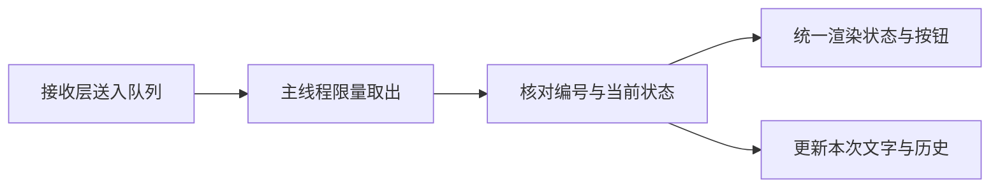
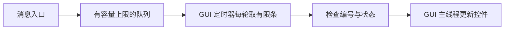

# 机器人可视化与监控工程师｜第二周专业知识自学清单

**学习目标：** 掌握信号与槽、队列刷新、状态机和迟到结果保护，配合[本周任务](../../task/02_第二次任务/机器人可视化与监控工程师.md)接入真实状态与文字。

下面是独立编写的 Python 教学示例，不引用项目源码。每个短例子可单独保存运行；窗口例子需要已经准备好的 PySide6 环境。第三节提供组合示例。所有窗口均为 DEMO，不接 ROS，也不进行真实识别。

## 一、显示流程框架



**图示说明：** 可视化岗位负责显示数据。数据接收、编号判断和控件更新各有作用，不需要在窗口中重复运行模型。

## 二、知识点讲解

### 1. 窗口与控件：先显示一行文字

`QApplication` 管理界面程序，`QWidget` 是窗口，`QLabel` 用来显示短文字。`show()` 显示窗口，`app.exec()` 开始处理点击、绘制等界面事件。

```python
from PySide6.QtWidgets import QApplication, QLabel, QWidget

app = QApplication([])
window = QWidget()
window.setWindowTitle("DEMO：第一个窗口")
window.resize(320, 120)
label = QLabel("等待数据", window)  # 把标签放在 window 中
label.move(20, 30)
window.show()
app.exec()  # 关闭窗口后，这次运行结束
```

**观察：** 出现一个显示“等待数据”的窗口。先认识控件，再用布局管理器替代手工指定位置。

### 2. 布局与文字区：让控件按顺序排列

`QVBoxLayout` 把控件从上到下排列，窗口变化时帮助调整位置。`QPlainTextEdit` 适合显示多行文字，设为只读后用户不能直接改结果。

```python
from PySide6.QtWidgets import QApplication, QLabel, QPlainTextEdit, QVBoxLayout, QWidget

app = QApplication([])
window = QWidget()
window.setWindowTitle("DEMO：状态与文字")
layout = QVBoxLayout(window)
status_label = QLabel("DEMO 演示")
text_area = QPlainTextEdit()
text_area.setReadOnly(True)
text_area.setPlainText("第一行演示文字\n第二行演示文字")
layout.addWidget(status_label)
layout.addWidget(text_area)
window.show()
app.exec()
```

**观察：** 状态在上方，长文字在下方。`setPlainText()` 替换文字，`clear()` 清空文字。

### 3. 自定义信号与槽：把数据入口和显示逻辑分开

`Signal` 定义可发出的通知，`Slot` 标记接收通知的方法。接收层发出编号与文字，显示层负责更新控件，这样以后替换数据来源时不用改动所有控件代码。

```python
from PySide6.QtCore import QObject, Signal, Slot
from PySide6.QtWidgets import QApplication, QLabel, QPushButton, QVBoxLayout, QWidget


class MessageBridge(QObject):
    received = Signal(str, str)  # 定义在类上：编号、文字


class ResultWindow(QWidget):
    def __init__(self):
        super().__init__()
        self.setWindowTitle("DEMO：信号与槽")
        self.label = QLabel("等待数据")
        self.button = QPushButton("模拟收到结果")
        self.bridge = MessageBridge(self)
        layout = QVBoxLayout(self)
        layout.addWidget(self.label)
        layout.addWidget(self.button)
        self.bridge.received.connect(self.show_result)
        self.button.clicked.connect(self.send_demo)

    def send_demo(self):
        self.bridge.received.emit("demo-001", "演示文字")

    @Slot(str, str)
    def show_result(self, request_id, text):
        self.label.setText(f"DEMO：{request_id} / {text}")


app = QApplication([])
window = ResultWindow()
window.show()
app.exec()
```

**观察：** 点击后由信号触发槽函数。本例所有对象都在主线程；若以后从其他线程送入数据，应使用接收对象属于 GUI 线程的槽和合适的队列连接，不直接在后台操作控件。

### 4. 队列与定时刷新：每次只处理有限条消息

接收数据与刷新界面的速度可能不同。`Queue` 暂存消息，主线程用 `get_nowait()` 取出；每轮设置条数上限，避免大量消息让界面长时间得不到处理。



```python
from queue import Queue, Empty, Full
from PySide6.QtCore import QTimer
from PySide6.QtWidgets import QApplication, QLabel

app = QApplication([])
label = QLabel("DEMO：尚未刷新")
inbox = Queue(maxsize=4)
for number in range(5):
    try:
        inbox.put_nowait(f"DEMO 消息 {number}")
    except Full:
        print("队列已满，拒绝新消息：", number)  # 明确演示溢出策略

processed = []


def drain():
    for _ in range(2):  # 一轮最多两条，不等队列出现新消息
        try:
            message = inbox.get_nowait()
        except Empty:
            break
        processed.append(message)
        label.setText(message)


timer = QTimer(label)
timer.timeout.connect(drain)
timer.start(100)
label.show()
app.exec()
```

**观察：** 第五条入队被拒绝，前四条分轮显示。这里没有后台线程；接入时应由接收层入队、GUI 主线程取队列并更新控件。最终结果不能随意丢弃，正式溢出策略需要和接口同伴约定。

### 5. 编号与序号：同时防止旧请求和旧进度覆盖

编号区分不同输入；同一输入内还可以用递增序号区分消息先后。只核对编号仍可能让迟到的旧进度覆盖最终结果，因此要同时检查序号和结束标记。

```python
current = {"request_id": "demo-002", "last_seq": -1, "finished": False, "text": ""}


def apply_message(message):
    if message["request_id"] != current["request_id"]:
        return "旧请求，忽略"
    if current["finished"] or message["seq"] <= current["last_seq"]:
        return "重复、旧序号或已结束，忽略"
    current["last_seq"] = message["seq"]
    if message["kind"] == "result":
        current.update(finished=True, text=message["text"])
    return "已接受"


messages = [
    {"request_id": "demo-001", "seq": 9, "kind": "result", "text": "旧文字"},
    {"request_id": "demo-002", "seq": 2, "kind": "progress", "text": ""},
    {"request_id": "demo-002", "seq": 1, "kind": "progress", "text": ""},
    {"request_id": "demo-002", "seq": 3, "kind": "result", "text": "DEMO 本次文字"},
    {"request_id": "demo-002", "seq": 4, "kind": "progress", "text": ""},
]
for message in messages:
    print(apply_message(message))
print("最终显示：", current["text"])
```

**注释：** 本例假定字段已经校验，序号由同一个发送方递增提供。实际接口如果没有序号字段，不能擅自假设存在，应先使用已约定的编号和状态规则。

### 6. 界面状态机：由状态统一决定文字和按钮

把空闲、等待、成功、失败列为明确状态，比在多个回调里分别修改提示更容易保持一致。状态机限制跳转，渲染规则根据当前状态统一生成显示内容。

```python
allowed = {"IDLE": {"WAITING"}, "WAITING": {"SUCCESS", "FAILED"},
           "SUCCESS": {"WAITING"}, "FAILED": {"WAITING"}}
state = {"phase": "IDLE", "text": "", "message": ""}


def change(target, text="", message=""):
    if target not in allowed[state["phase"]]:
        raise ValueError("不允许的状态跳转")
    if target == "SUCCESS" and not text.strip():
        raise ValueError("成功状态必须有文字")
    state.update(phase=target, text=text if target == "SUCCESS" else "", message=message)


def view_data():
    return {"button_enabled": state["phase"] != "WAITING",
            "status": state["phase"], "text": state["text"], "message": state["message"]}


change("WAITING")
print(view_data())
change("FAILED", message="DEMO：文件不存在")
print(view_data())
change("WAITING")
change("SUCCESS", text="DEMO 新结果")
print(view_data())
```

**观察：** 等待时按钮应禁用，失败时文字为空，下一次成功时才显示新文字。真实程序可在一个 `render()` 方法内把这些字段写入标签、文字区和按钮；状态名按接口映射。

### 7. 输入校验联动：内容有效时才允许点击

输入框的 `textChanged` 信号可以驱动校验。将“读取、校验、按钮启用、错误提示”放在同一函数中，避免按钮看似可用却提交空内容。

```python
from pathlib import Path
from PySide6.QtWidgets import QApplication, QLabel, QLineEdit, QPushButton, QVBoxLayout, QWidget

app = QApplication([])
window = QWidget()
window.setWindowTitle("DEMO：输入校验联动")
layout = QVBoxLayout(window)
input_box = QLineEdit()
input_box.setPlaceholderText("输入录音文件名，例如 sample.wav")
label = QLabel()
button = QPushButton("确认演示输入")
for widget in [input_box, button, label]:
    layout.addWidget(widget)


def validate():
    name = input_box.text().strip()
    valid = bool(name) and Path(name).suffix.lower() == ".wav"
    button.setEnabled(valid)
    label.setText("DEMO：文件名形式可接受" if valid else "请填写 .wav 文件名")


def submit():
    label.setText(f"DEMO：已确认 {input_box.text().strip()}")


input_box.textChanged.connect(validate)
button.clicked.connect(submit)
validate()  # 初始化时也要校验，不能只等用户修改
window.show()
app.exec()
```

**观察：** 输入空白或 `.txt` 时按钮禁用，输入 `a.wav` 时启用。本例只检查文件名形式，不能证明路径存在、WAV 格式正确或录音包含语音。

### 8. 超时与迟到结果：用请求代次保护界面

等待超时后应恢复按钮并显示原因。延迟结果仍可能到达，因此回调要检查代次编号和当前状态；停止等待不会自动停止后端工作。

```python
from PySide6.QtCore import QTimer
from PySide6.QtWidgets import QApplication, QLabel, QPushButton, QVBoxLayout, QWidget

app = QApplication([])
window = QWidget()
window.setWindowTitle("DEMO：超时保护")
layout = QVBoxLayout(window)
label = QLabel("等待开始")
button = QPushButton("模拟慢响应")
layout.addWidget(label)
layout.addWidget(button)
state = {"generation": 0, "waiting": False}
deadline = QTimer(window)
deadline.setSingleShot(True)


def on_timeout():
    state["waiting"] = False
    button.setEnabled(True)
    label.setText("DEMO：等待超时，未显示成功文字")


def on_result(generation, text):
    if generation != state["generation"] or not state["waiting"]:
        return  # 旧代次或等待已结束，不能覆盖当前界面
    deadline.stop()
    state["waiting"] = False
    button.setEnabled(True)
    label.setText(text)


def start():
    state["generation"] += 1
    generation = state["generation"]  # 闭包保留本次代次
    state["waiting"] = True
    button.setEnabled(False)
    label.setText("DEMO：正在等待")
    deadline.start(150)
    QTimer.singleShot(300, lambda: on_result(generation, "DEMO：迟到文字"))


deadline.timeout.connect(on_timeout)
button.clicked.connect(start)
window.show()
app.exec()
```

**观察：** 150 ms 后显示超时，300 ms 到来的文字被忽略。定时器触发并非精确截止时刻；严格的截止判断还应核对单调时钟，组合示例展示这种检查。

### 9. 有界历史：按编号更新，并限制保留条数

同一个请求可能收到多次状态更新。把编号存入条目的 `UserRole`，找到已有条目后修改；新增条目超过上限时移除最旧项，避免列表不断增长。

```python
from PySide6.QtCore import Qt
from PySide6.QtWidgets import QApplication, QListWidget, QListWidgetItem

app = QApplication([])
history = QListWidget()
history.setWindowTitle("DEMO：按编号更新历史")
items = {}
limit = 3


def update_record(request_id, text):
    item = items.get(request_id)
    if item is None:
        item = QListWidgetItem()
        item.setData(Qt.ItemDataRole.UserRole, request_id)
        history.addItem(item)
        items[request_id] = item
    item.setText(f"{request_id}：{text}")
    while history.count() > limit:
        removed = history.takeItem(0)
        del items[removed.data(Qt.ItemDataRole.UserRole)]


update_record("a", "DEMO 等待")
update_record("a", "DEMO 完成")  # 更新已有条目，不增加一行
for request_id in ["b", "c", "d"]:
    update_record(request_id, "DEMO 完成")
history.show()
app.exec()
```

**观察：** 最后只保留 `b、c、d` 三项。这个历史按首次加入顺序保留，仅存在内存中；条目去重也不能代替接口层防止业务重复执行。

### 10. 退出清理：停止自己创建的定时器

界面退出时，应清理自己创建的资源。`aboutToQuit` 会在应用准备退出时发出，可以连接清理函数，让定时器停止。

```python
from PySide6.QtCore import QTimer
from PySide6.QtWidgets import QApplication, QLabel

app = QApplication([])
label = QLabel("DEMO：关闭这个窗口，观察终端提示")
timer = QTimer(label)
timer.timeout.connect(label.update)  # 演示一个周期刷新


def cleanup():
    timer.stop()
    print("DEMO：定时器已停止")


app.aboutToQuit.connect(cleanup)
timer.start(1000)
label.show()
app.exec()
```

**观察：** 正常关闭窗口后，终端出现停止提示。这个信号不能保证强制终止时仍能清理；以后接 ROS 或线程时，还需处理自己创建的节点和线程，不关闭其他同学启动的后端。

## 三、组合示例：队列、编号与超时共同保护显示

把整个代码块保存为 `demo_window.py`，在已有 PySide6 环境中运行。模拟接收层只向队列放消息，定时器在 GUI 主线程取消息、核对状态并刷新。全部文字与延迟均为 DEMO，不连接项目或真实 ASR。

```python
from queue import Queue, Empty, Full
from time import monotonic
from PySide6.QtCore import QTimer
from PySide6.QtWidgets import (
    QApplication, QLabel, QPlainTextEdit, QPushButton, QVBoxLayout, QWidget,
)

app = QApplication([])
window = QWidget()
window.setWindowTitle("DEMO：结果关联与超时")
window.resize(440, 320)
layout = QVBoxLayout(window)
status_label = QLabel("DEMO：等待输入")
id_label = QLabel("本次编号：无")
text_area = QPlainTextEdit()
text_area.setReadOnly(True)
button_a = QPushButton("演示第一份")
button_b = QPushButton("演示第二份")
button_error = QPushButton("演示失败")
button_slow = QPushButton("演示超时")
for widget in [status_label, id_label, text_area, button_a, button_b, button_error, button_slow]:
    layout.addWidget(widget)

inbox = Queue(maxsize=8)
state = {"request_id": "", "sequence": 0, "phase": "IDLE", "deadline": 0.0}


def enqueue(message):
    try:
        inbox.put_nowait(message)
    except Full:
        print("DEMO：队列已满，本条未入队")  # 正式业务须约定溢出处理


def start_demo(text, success, delay_ms=350):
    state["sequence"] += 1
    request_id = f"demo-{state['sequence']}"
    state.update(request_id=request_id, phase="WAITING", deadline=monotonic() + 0.6)
    id_label.setText(f"本次编号：{request_id}")
    text_area.clear()
    status_label.setText("DEMO：正在等待")
    # 闭包记住本次编号，不在消息到达时读取可能已经改变的当前编号。
    message = {"request_id": request_id, "success": success, "text": text}
    QTimer.singleShot(delay_ms, lambda: enqueue(message))


def drain():
    if state["phase"] == "WAITING" and monotonic() >= state["deadline"]:
        state["phase"] = "TIMEOUT"
        status_label.setText("DEMO：等待超时")
        text_area.clear()
    for _ in range(4):  # 每轮工作量有上限
        try:
            message = inbox.get_nowait()
        except Empty:
            break
        if message["request_id"] != state["request_id"] or state["phase"] != "WAITING":
            continue  # 旧编号、重复结果、超时后的迟到结果均不再显示
        if monotonic() >= state["deadline"]:
            state["phase"] = "TIMEOUT"
            status_label.setText("DEMO：等待超时")
            text_area.clear()
            continue
        text = message["text"].strip()
        if message["success"] and text:
            state["phase"] = "SUCCESS"
            status_label.setText("DEMO：结果已到达")
            text_area.setPlainText(text)
        else:
            state["phase"] = "FAILED"
            status_label.setText("DEMO：处理失败")
            text_area.clear()


timer = QTimer(window)
timer.timeout.connect(drain)
timer.start(50)
app.aboutToQuit.connect(timer.stop)
button_a.clicked.connect(lambda: start_demo("第一份演示文字", True))
button_b.clicked.connect(lambda: start_demo("第二份演示文字", True))
button_error.clicked.connect(lambda: start_demo("", False))
button_slow.clicked.connect(lambda: start_demo("不应显示的迟到文字", True, 900))
window.show()
app.exec()
```

**动手改一改：** 先点第一份，快速点第二份，观察旧结果是否被忽略；再点失败与超时，确认旧文字被清空、迟到文字不覆盖提示。队列消息的字段在本例中由程序自己保证，接真实来源时还需在入口做校验。

## 四、思考与练习

1. 为什么接收层入队、GUI 主线程更新控件，比接收回调直接改控件更容易维护？
2. 只核对请求编号，能否防止同一请求的旧进度覆盖最终结果？
3. 超时后按钮已经恢复，旧结果才到达时应检查什么？为什么还需检查截止时刻？

将自己的解释、示例运行结果和任务步骤合并为一份说明。信号、队列和超时先用独立示例练习；线程生命周期、历史持久化和断线恢复放到后续学习。

## 五、参考资料

- [Qt for Python：第一个窗口](https://doc.qt.io/qtforpython-6/tutorials/basictutorial/widgets.html)。
- [Qt for Python：QTimer](https://doc.qt.io/qtforpython-6/PySide6/QtCore/QTimer.html)。
- [Qt for Python：QLineEdit](https://doc.qt.io/qtforpython-6/PySide6/QtWidgets/QLineEdit.html)。
- [Qt for Python：QListWidget](https://doc.qt.io/qtforpython-6/PySide6/QtWidgets/QListWidget.html)。
- [Qt for Python：退出信号](https://doc.qt.io/qtforpython-6/PySide6/QtCore/QCoreApplication.html)。
- [Qt for Python：自定义信号与槽](https://doc.qt.io/qtforpython-6/tutorials/basictutorial/signals_and_slots.html)。
- [Python：线程安全队列](https://docs.python.org/3.10/library/queue.html)。
